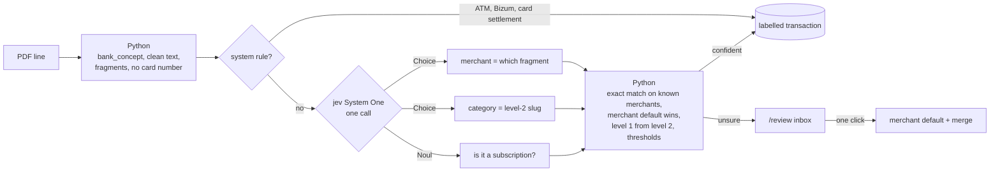

# personal-finance-agent

Local-first personal finance assistant: import bank exports, categorize
transactions with a rules → jev → human cascade, explore dashboards, and chat
with your finances through an LLM agent over a semantic layer.

## Status

Slice 1 (ingestion), slice 2 (categorization with jev and the `/review`
inbox) and slice 3 (the dashboards: an overview, spending, income and merchant
pages, a transactions explorer and subscriptions, next to the review and import
pages) are complete. Slice 4a, the chat agent backend (its API and
`finance chat`), is complete; the `/chat` page comes next (4b). Design:
`docs/superpowers/specs/`. Plans: `docs/superpowers/plans/`.

## How jev categorizes transactions

Bank lines are cryptic (`PAGO CON TARJETA EN SUPERMERCADOS | 1234… SUPER ACME
0042 L`), and a person wants to see "Super Acme, Shopping > Groceries". This project
uses [jev](https://typesafe.ai), TypeSafe AI's System One model, for
the judgement calls. Deterministic Python handles everything else.

jev does not generate text. It answers typed questions about a JSON state:
a [`Choice`](https://docs.typesafe.ai/primitives/choice) returns a probability
for every option, and a [`Noul`](https://docs.typesafe.ai/primitives/noul)
returns the probability of yes. Each transaction becomes one call with three
independent questions. Operations without a merchant (ATM, card
settlement, Bizum, own transfers) are resolved by deterministic rules before
jev, and a merchant the user has already labelled keeps that label. The
cascade always runs in the same order: own-account pairing → system rules →
jev → merchant defaults → review.



How the design follows jev's documented patterns:

- **Code proposes, jev chooses.** Python cuts the text into 1–4 word
  fragments and jev picks the brand name
  ([pre-parsed value extraction](https://docs.typesafe.ai/cookbooks/pre_parsed_value_extraction_cookbook)).
  There is no merchant list to maintain: a shop in a new country works on day
  one.
- **One call, many questions.** Merchant, category and subscription are asked
  together and answered independently
  ([parallel questions](https://docs.typesafe.ai/cookbooks/parallel_questions)).
- **Two-level taxonomy from one question.** jev picks the level-2 category;
  level 1 and its confidence come from summing the leaf probabilities, so an
  uncertain "groceries vs. other shopping" still reports "Shopping" with
  confidence
  ([classification using confidence](https://docs.typesafe.ai/cookbooks/classification_using_confidence)).
- **Confidence drives routing.** Per-decision thresholds send only uncertain
  rows to a human, and the same merchant is merged only at ≥ 0.8
  ([confidence](https://docs.typesafe.ai/confidence)).

The spike on 412 real transactions (six rounds, `jev-1.13.0`) cost under
$0.05 per run with the final taxonomy of 55 categories, about 2,700 input
tokens per transaction. It unified every branch and truncation of the same
supermarket under one merchant. Against 412 hand-checked labels, jev was
right on 99% of the rows it scored at 0.95 or more, which set the acceptance
threshold; the rest goes to review, once per merchant. Round-by-round results and lessons are in
[the spike write-up](docs/superpowers/spikes/2026-09-23-jev-categorization/README.md).
Full design: spec sections 4.2 and 5.

How the numbers add up (refunds, loans, credit cards, transfers): [docs/money-rules.md](docs/money-rules.md).

### Measuring it

`cd apps/api && uv run finance eval-categorization --note "what changed"` runs
the production cascade as a dry run against your own labels (the golden set)
and appends one line to [`docs/evals/HISTORY.md`](docs/evals/HISTORY.md); the
row-level results stay in the git-ignored `eval-output/`, and the run's jev
calls form one Langfuse trace tagged `eval`. The first production run, with
pairing and system rules in front of jev, accepted 265 of 412 labelled
transactions at 0.95 with 3 errors (98.9% precision) and sent 147 to review,
against 97.2–97.6% and 158–164 for the jev-only spike runs, for about $0.04.

## How the chat agent answers

Ask "how much did I spend on groceries in March?" and an agent answers with a
number it queried in that turn, plus a few words on how it counted it. The
chat does not use jev: jev categorizes, and the chat is an LLM (xAI grok by
default) over a semantic layer.

- **One agent, one tool.** A ReAct loop built with LangChain's
  [`create_agent`](https://docs.langchain.com/oss/python/langchain/agents) and
  a single tool, `run_sql`, that runs one read-only `SELECT`. There is no
  router: looking up an exact merchant name, reading the notes and the final
  query are all `run_sql` calls.
- **Read-only in three layers.** The agent sees only the `agent` schema: two
  views, `transactions` and `subscriptions`, thin projections of the dashboard
  views, so the money rules live in one place. They hold no ids, IBANs or raw
  bank descriptions. Every query passes a `sqlglot` guard (one statement, read
  nodes only, known tables, no `set_config`, no function it does not recognise
  unless allowlisted), then runs as the `agent_reader`
  role (no login, set with `SET LOCAL ROLE`) in a read-only transaction with a
  timeout. A SQL error goes back to the model with a hint; a database outage
  ends the turn with a fixed message.
- **The semantic layer** lives in `apps/api/finance/agent/semantic/`: one YAML
  file per view with its knowledge (what a row is, what to use it for and what
  not) and its attributes (a kind, such as measure, dimension or text, and a
  description written for the agent), plus metric definitions and query
  examples. Only values the app defines are listed (banks, categories from the
  taxonomy, accounts with their statement coverage); merchants, bank texts and
  notes are explored with lookup queries. Column types come from Postgres. When
  the API or `finance chat` starts, the YAML is checked against the live views,
  and every metric and example step goes through the SQL guard and an `EXPLAIN`
  as `agent_reader`: a changed view fails loudly instead of leaving the agent
  with broken patterns.
- **Instructions and data context.** The instructions
  (`apps/api/finance/agent/prompts/system.md`) are static: scope, workflow,
  dates, comparisons, answer format. The data context is built every turn: the
  semantic layer with its values, the metrics, the examples, today's date and
  the latest imported date. Both are joined only when the model is called and
  never stored in the chat, so changing either never breaks an existing chat.
- **Notes.** A note you write on a movement is how the agent finds what was
  bought or why. It reads the distinct notes and picks them by meaning instead
  of guessing a search word.
- **Middleware.** A long chat is summarized at 150,000 tokens; old query
  results leave the request (their SQL stays); a turn makes at most 8 queries
  and 12 model calls; a query left open by a stopped answer is closed on the
  next turn.
- **Persistence.** A LangGraph Postgres checkpointer holds the agent's memory
  of each chat; checkpoints load with a strict msgpack allowlist, so only safe
  types are revived from the database. `chat_threads` and `chat_messages` hold
  what you see: titles, answers with their queries, a status (ok, error,
  stopped) and your feedback. A stopped answer or a database outage leaves the
  chat usable.
- **Langfuse.** One trace per turn and one session per chat, tagged with the
  prompt and semantic-layer versions and the model. Each turn gets scores
  (queries, query errors, query limit reached, stopped, infrastructure error),
  and a thumbs up or down becomes a `user-feedback` score on that answer's
  trace.

The model provider and Langfuse receive your questions, the SQL and its
results (merchant names, amounts, dates, notes, account names), never IBANs or
raw bank descriptions.

```bash
cd apps/api
uv run finance chat                                # ask until an empty line (xAI spend)
uv run finance chat "how much did I spend last month?"
uv run finance chat "and the month before?" --thread <chat id>   # continue a chat; the id is printed first
```

Terminal chats are the same chats the API serves. The defaults (models,
reasoning effort, limits) are in `ChatSettings` in
`apps/api/finance/settings.py`; override any of them in `.env` with
`CHAT__<FIELD>`, for example `CHAT__REASONING_EFFORT=medium`. Full design:
[the slice 4 spec](docs/superpowers/specs/2026-10-12-slice-4-chat-design.md).

## Local setup

Requirements: Docker, [uv](https://docs.astral.sh/uv/), Node 22, [Supabase CLI](https://supabase.com/docs/guides/cli).

```bash
cp .env.example .env            # SUPABASE_DB_URL is required; TYPESAFE_API_KEY enables categorization, XAI_API_KEY the chat, LANGFUSE_* tracing
supabase start                  # local Postgres; copy the DB URL into .env as SUPABASE_DB_URL
supabase db reset               # apply migrations (export your labels first once you have some)
(cd apps/api && uv run finance seed)   # load the category taxonomy and system rules
```

`XAI_API_KEY` enables the chat. A database you already use gets new
migrations with `supabase migration up` from the repo root; never run
`supabase db reset` once it holds labels you care about.

Start the API only after `supabase start` (and `supabase migration up` on an
existing database): at startup it opens the chat and stops with an error if
the database is unreachable or the semantic layer does not match the views.
Without `XAI_API_KEY` the API still starts and the chat routes answer 503.

```bash
# terminal 1, from the repo root
cd apps/api && uv sync --group dev && uv run task api
```

```bash
# terminal 2, from the repo root
cd apps/web && npm install && npm run dev
```

Open http://localhost:3000/imports and upload a BBVA or CaixaBank PDF statement,
or run `cd apps/api && uv run finance import ../../data/raw/<statement.pdf>`.
With `TYPESAFE_API_KEY` set, every import is categorized right away; open
http://localhost:3000/review for what jev was unsure about.

```bash
cd apps/api
uv run finance categorize         # categorize pending rows (--all re-runs every row you have not labelled)
uv run finance labels export      # back up your labels to data/labels/ (git-ignored; --force overwrites)
uv run finance labels import ../../data/labels/<file>.csv   # restore them after a reset
```

A reset also loses the merchant defaults: the labels CSV holds labels only. To
restore, run `finance seed`, re-import the statements with `TYPESAFE_API_KEY=`
(empty, so no paid categorize run happens), `finance labels import`, then
`finance categorize`.

Real statements go in `data/raw/` (git-ignored). Uploading the same file twice
never duplicates a transaction.

## Known limitations

- If a bank changes a settled transaction's description between two exports,
  that transaction appears twice.
- Two movements are treated as the same transaction only when their date,
  amount, description and printed balance all match. With a running balance
  that requires the movements between them to net to zero (for example a
  charge, its reversal, and the same charge again on one day). If two exports
  cut in the middle of such a day each contain a different one of the matching
  movements, the later import skips it.
- A failed import (unsupported file, unreadable PDF, broken balance chain) is
  reported to you but not recorded in the import history. Nothing from the
  file is saved.
- Every upload is recorded in the import history, including re-uploads that
  add no new rows.

## License

MIT, see [LICENSE](LICENSE).
