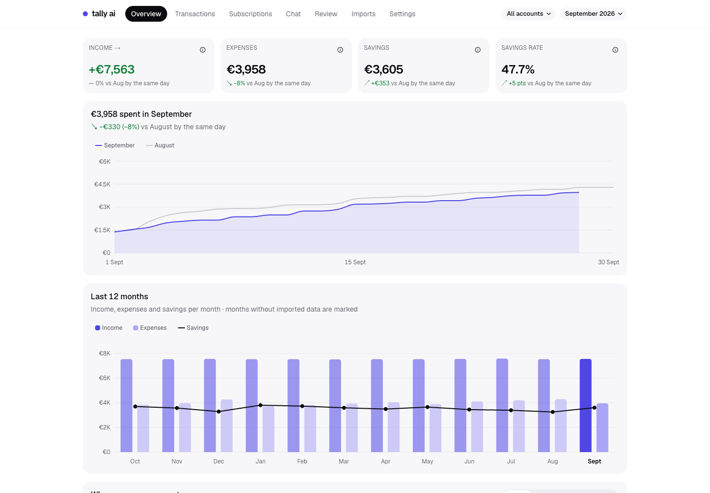
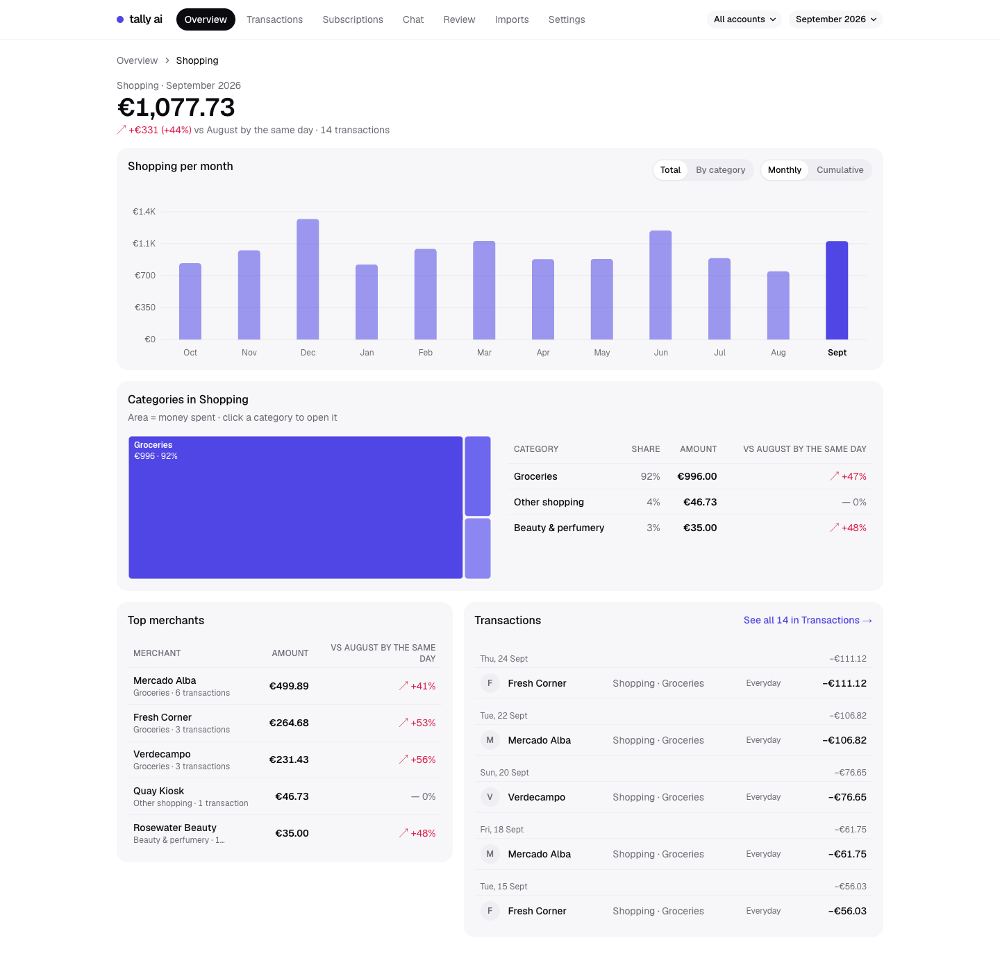
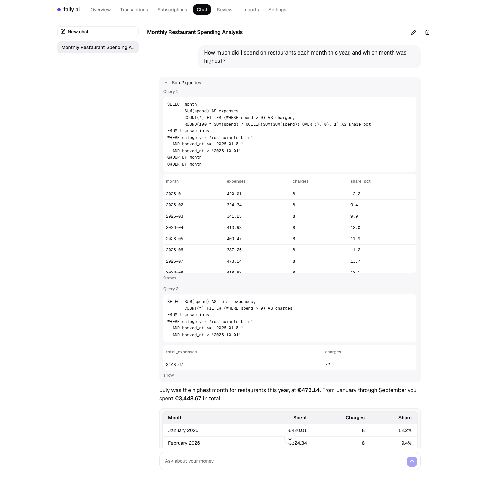
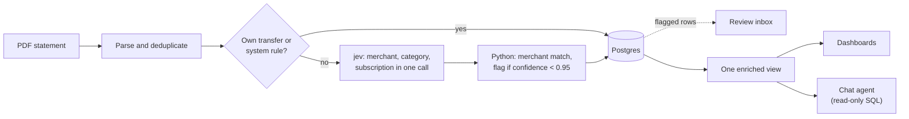

# tally ai

Local-first personal finance. Import your bank's PDF statements, let a rules → jev (a
classification model) → human cascade categorize every movement, see where each month went, and
ask questions in plain language.



<sub>Every screenshot shows twelve months of synthetic data.</sub>

## What it does

- **Imports without duplicates.** Upload a BBVA or CaixaBank PDF statement. Uploading it again
  adds nothing.
- **Learns each merchant once.** Rules and jev categorize. What jev is unsure about waits in a
  review inbox, one decision per merchant.
- **Shows the month.** Income, spending, savings rate, a 12-month trend, every category and
  merchant, and the subscriptions you pay.
- **Answers questions.** A chat agent queries your data with read-only SQL and shows the queries
  behind its answers.



<sub>A category page: twelve months of bars, where the money went inside the group, and its top merchants.</sub>



<sub>The chat answers with the queries it ran, opened above the answer.</sub>

## How it is built



- **jev chooses, Python decides.** [jev](https://typesafe.ai) answers three typed questions
  per transaction ([`Choice`](https://docs.typesafe.ai/primitives/choice) and `Noul`): which
  fragment of the bank text is the merchant, which category it is, and whether it is a
  subscription. Each comes back with a probability per option. Deterministic code does
  everything else: parsing, deduplication, transfer pairing, exact merchant matching and
  thresholds. [Categorization →](docs/architecture.md#categorization)
- **Measured, not assumed.** On the latest eval (824 labelled transactions), 83.0% get
  the right category. At the 0.95 threshold the cascade accepts 476 of them with 97.1%
  precision and sends 348 to review. The threshold comes from the spike, where jev was right
  on 99% of the 254 rows it scored at 0.95 or more. [Evals →](docs/architecture.md#evals)
- **A ReAct agent over a semantic layer.** LangChain `create_agent` with one tool, `run_sql`,
  and a LangGraph Postgres checkpointer for each chat's memory. The agent queries two views
  through a read-only Postgres role, with an xAI grok model by default. [Chat →](docs/architecture.md#chat)
- **One money contract.** Every total, on every page and in the chat, comes from one view under
  written rules for refunds, card settlements, transfers and loans. [Money →](docs/architecture.md#money)

**Stack:** Python 3.12, FastAPI, Supabase Postgres, LangChain and LangGraph, jev (TypeSafe AI),
xAI grok, Langfuse, Next.js 16, the AI SDK and shadcn/ui.

## Run it locally

Requirements: Docker, [uv](https://docs.astral.sh/uv/), Node 22 and the
[Supabase CLI](https://supabase.com/docs/guides/cli).

```bash
cp .env.example .env     # SUPABASE_DB_URL is required; TYPESAFE_API_KEY categorizes; XAI_API_KEY enables the chat
supabase start           # local Postgres; put its DB URL in .env as SUPABASE_DB_URL
supabase db reset        # first run only: applies the migrations to an empty database
(cd apps/api && uv sync --group dev && uv run finance seed)
```

```bash
cd apps/api && uv run task api     # terminal 1: API on :8000
cd apps/web && npm install && npm run dev   # terminal 2: web on :3000
```

Open http://localhost:3000/imports and upload a statement. With `TYPESAFE_API_KEY` set, it is
categorized right away, and http://localhost:3000/review holds what jev was unsure about.

`supabase db reset` wipes the whole local database, including your labels, notes and merchant
defaults. Once you have labels, run `(cd apps/api && uv run finance labels export)` first, and
apply new migrations with `supabase migration up` instead. The commands and the restore
procedure are in [CLAUDE.md](CLAUDE.md).

## Limits

- Reads BBVA and CaixaBank PDF statements only.
- The chat is told to answer only with figures it queried, but nothing enforces that yet, and
  there are no chat evals.
- Single-user and local: the tables have no row-level security, so do not host it as is.

More in [docs/architecture.md](docs/architecture.md#limits). What leaves your machine is listed
under [Privacy](docs/architecture.md#privacy).

## License

MIT, see [LICENSE](LICENSE).
