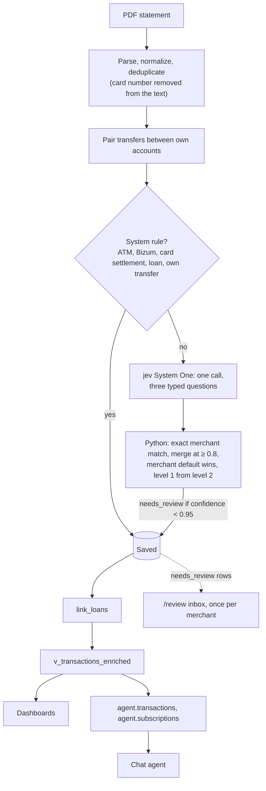

# How tally ai is built

This page is for someone checking the code. It explains what each part does and why, and points
to the files that implement it. It is not the spec or the prompt: both are linked at the end.

## Pipeline

Ingestion reads BBVA and CaixaBank PDFs (`apps/api/finance/ingestion/`). A movement's dedup key
(`apps/api/finance/ingestion/dedup.py`) hashes the account, date, amount, description, printed
balance and occurrence, so uploading the same file twice adds nothing.

## Categorization

Bank lines are cryptic (`PAGO CON TARJETA EN SUPERMERCADOS | … SUPER ACME 0042 L`), and a person
wants "Super Acme, Shopping > Groceries". [jev](https://typesafe.ai), TypeSafe AI's System One
model, makes the judgment calls. It does not generate text. It answers typed questions about a
JSON state: a [`Choice`](https://docs.typesafe.ai/primitives/choice) returns a probability for
every option, and a [`Noul`](https://docs.typesafe.ai/primitives/noul) returns the probability
of yes.

- **Code proposes, jev chooses.** Python cuts the text into 1–4 word fragments, and jev picks the
  brand name
  ([pre-parsed value extraction](https://docs.typesafe.ai/cookbooks/pre_parsed_value_extraction_cookbook)).
  There is no merchant list to maintain.
- **One call, three questions.** The merchant fragment, the level-2 category and the
  subscription question are asked together and answered independently
  ([parallel questions](https://docs.typesafe.ai/cookbooks/parallel_questions);
  `apps/api/finance/categorization/jev_questions.py`).
- **Two levels from one question.** Level 1 is the parent of the chosen level-2 category, and
  its confidence is the sum of its leaf probabilities
  ([classification using confidence](https://docs.typesafe.ai/cookbooks/classification_using_confidence)).
- **Confidence drives routing.** Rows under 0.95 go to a person. A new name that shares a word
  with a known merchant gets one more question, whether it is the same business, and is merged
  only at ≥ 0.8 (`merge_threshold` in `apps/api/finance/settings.py`). A merchant the user has
  labelled keeps that label as its default.
- **Where 0.95 came from.** In the [jev spike](superpowers/spikes/2026-09-23-jev-categorization/README.md)
  (412 labelled rows), jev was right on 99% of the 254 rows it scored at 0.95 or more.
  Between 0.7 and 0.95, a higher score was not more reliable: a 0.88 was about as often right
  as a 0.75.

Deterministic Python owns everything that is not a judgment call: parsing, deduplication,
transfer pairing, system rules, exact merchant matching, thresholds and `link_loans`
(`apps/api/finance/categorization/loans.py`), which links each loan row to its loan after save.

## Evals

`finance eval-categorization --note "…"` runs the production cascade as a dry run against the
golden set (the user's labels). It appends one line to [`HISTORY.md`](evals/HISTORY.md) and
records the run's jev calls as one Langfuse trace. Row-level results stay in the git-ignored
`eval-output/`.

The latest line (2026-09-27, 684 golden rows): level-2 accuracy 87.0%, level-1 accuracy 89.2%.
At the 0.95 threshold, 397 rows are accepted with 98.2% precision and 287 go to review.
Subscription precision is 50/51 and recall 50/60.

The first 412 labels were drafted by a model blind to jev's answers, and the user reviewed the
ones that disagreed with jev or were doubtful (see the
[spike write-up](superpowers/spikes/2026-09-23-jev-categorization/README.md)).

Read the history with two caveats. The golden set grew between lines (412, then 480, then 684
rows), so the lines are not a trend. And run-to-run noise is about ten rows, so smaller
differences mean nothing.

## Chat

The chat does not use jev. It is an LLM (`xai:grok-4.7` by default) over a semantic layer.

- **One agent, one tool.** A ReAct loop built with LangChain's
  [`create_agent`](https://docs.langchain.com/oss/python/langchain/agents)
  (`apps/api/finance/agent/graph.py`) and a single tool, `run_sql`, that runs one read-only
  `SELECT`. There is no router.
- **Read-only in three layers.** The agent sees only the `agent` schema: `agent.transactions`
  and `agent.subscriptions`, thin projections of the dashboard views, without ids, IBANs or raw
  bank descriptions. Every query first passes a `sqlglot` guard (`agent/sql_guard.py`). It then
  runs as the `agent_reader` role in a read-only transaction with a timeout (`agent/sql_runner.py`).
- **Semantic layer.** One YAML file per view, plus metrics and query examples, in
  `apps/api/finance/agent/semantic/`. At startup the YAML is checked against the live views, and
  every metric and example goes through the guard and an `EXPLAIN`. A changed view fails loudly.
- **Middleware.** A turn makes at most 8 queries and 12 model calls. A long chat is summarized at
  150,000 tokens, and old query results leave the request (`ChatSettings` in
  `apps/api/finance/settings.py`).
- **Persistence.** A LangGraph `AsyncPostgresSaver` holds the agent's memory of each chat.
  `chat_threads` and `chat_messages` hold what the UI shows: answers, their queries, status and
  feedback.
- **Transport.** The browser streams with the AI SDK's
  [`useChat`](https://ai-sdk.dev/docs/reference/ai-sdk-ui/use-chat). The agent itself stays in
  Python.
- **Langfuse.** One trace per turn, one session per chat, and scores per turn. A thumbs up or
  down becomes a `user-feedback` score.

The v1 spec's section 9 describes a jev router in front of the chat. That router was not built.
The [slice 4 spec, section 16](superpowers/specs/2026-10-12-slice-4-chat-design.md) is the
amendment.

Known gaps, from [the backlog](backlog.md):
- The agent is told to answer with a figure it queried in the same turn, but nothing checks that
  it did ([item 8](backlog.md#8-numbers-the-chat-agent-can-be-trusted-with)).
- There are no chat evals ([item 6](backlog.md#6-chat-evals)).
- The agent cannot answer balances yet ([item 5](backlog.md#5-account-balances-in-the-chat)).

## Money

The category decides whether a row is income, spending or a transfer. Money moved between your
own accounts and money borrowed are neither income nor spending. Every total on every page and
in the chat comes from `v_transactions_enriched`, under the rules in
[money-rules.md](money-rules.md).

## Privacy

The database is local. jev receives the cleaned bank text and the amount (`jev_state` in
`apps/api/finance/categorization/jev_questions.py`), and Langfuse records each jev call. The chat
model and Langfuse receive the question, the SQL and the rows it returned: merchant names, cleaned
bank text, amounts, dates, notes and account names (the `agent.transactions` columns in
`supabase/migrations/20261014130000_display_names.sql`). None of them receives an account's IBAN or
the raw bank description (`description_raw`).

## Where to read next

| Document | What it is |
|---|---|
| [README](../README.md) | What tally ai does and how to run it |
| [money-rules.md](money-rules.md) | The contract for every total |
| [evals/HISTORY.md](evals/HISTORY.md) | Every categorization benchmark run |
| [jev spike](superpowers/spikes/2026-09-23-jev-categorization/README.md) | Seven rounds on real data that set the design and the threshold |
| [Slice 4 spec](superpowers/specs/2026-10-12-slice-4-chat-design.md) | The chat agent as built |
| [Chat prompt](../apps/api/finance/agent/prompts/system.md) | The chat agent's system prompt |
| [v1 spec](superpowers/specs/2026-09-22-personal-finance-agent-v1-design.md) | The original design. Amended: do not read its section 9 as the shipped chat |
| [backlog.md](backlog.md) | Ideas that are not designed or built yet |

## Limits

- Reads BBVA and CaixaBank PDF statements only.
- Chat figures are not checked against the queries (backlog item 8). There are no chat evals and
  no balances.
- The `public` tables have no row-level security. This is a single-user local app, not a hosted
  one.
