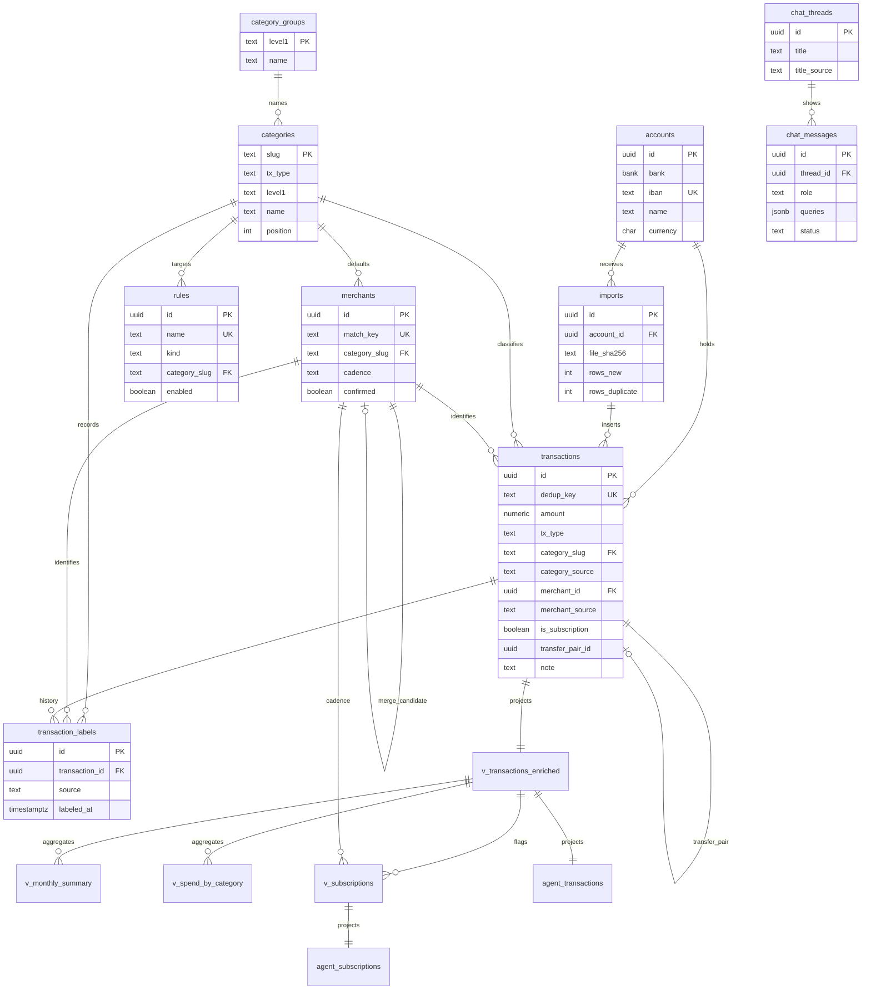

# Data model and migrations

The database is one local Postgres, applied in timestamp order from `supabase/migrations`. Tables hold the ledger, the taxonomy, and the chat UI. Views compute the money. The chat agent never reads the tables: it reads two projections in schema `agent`, as the `agent_reader` role. How those numbers are defined is [Money rules](../../docs/money-rules.md); this page only says which object owns them and what a later migration must not break.

`supabase db reset` applies every migration to an empty database and wipes labels, notes, and merchant defaults. After the first run, apply a new file with `supabase migration up`. Then run `uv run finance seed` so `categories`, `category_groups`, and `rules` match the YAML. Chat checkpoint tables are not in these migrations; the API creates them on startup.

Ledger, taxonomy, money views, the agent projections, and the chat UI tables. `v_subscriptions` also reads `merchants.cadence`. LangGraph checkpoint tables are outside this diagram.

## Who owns what

| Object | Created or last reshaped by | Written by | Read by |
|---|---|---|---|
| `accounts`, `imports`, `transactions` | [init](../../supabase/migrations/20260922000000_init.sql), then categorization, slice 3, display names | Import, pairing, categorization, review | Dashboards, views |
| `categories`, `merchants`, `rules`, `transaction_labels` | [categorization](../../supabase/migrations/20260924000000_categorization.sql); rules and merchants later | `finance seed`, categorization, review | Cascade, catalog |
| `v_transactions_enriched` and the two summary views | [slice 3 views](../../supabase/migrations/20260925110000_slice3_views.sql); enriched replaced in place by display names | Nobody (views) | Dashboards, agent projection |
| `v_subscriptions` | Recreated by [subscription cadence](../../supabase/migrations/20261014120000_subscription_cadence.sql) | Nobody (view) | Subscriptions page, `agent.subscriptions` |
| schema `agent`, `agent_reader`, `chat_threads`, `chat_messages` | [slice 4 chat](../../supabase/migrations/20261012000000_slice4_chat.sql); both agent views reshaped later | Chat store writes the two tables | `run_sql`, chat UI |
| LangGraph checkpoint tables | `AsyncPostgresSaver.setup()` at chat startup, not a migration | The checkpointer | The agent graph |

Public tables have no row-level security. That is acceptable only because this is a single-user local app. Do not expose them through the Supabase Data API or host the project as-is. The `agent` schema is already outside that API.

## Ledger

[init](../../supabase/migrations/20260922000000_init.sql) creates the `bank` enum (`bbva`, `caixabank`) and the three ledger tables.

`accounts` is one row per IBAN. Import inserts it the first time a statement arrives, naming it from the bank and the last four IBAN characters. `PATCH /accounts/{id}` can rename it; the API returns only those last four characters, never the IBAN. Currency defaults to `EUR`.

`imports` is one uploaded file: SHA-256, statement period, and `rows_total`, `rows_new`, `rows_duplicate`. Uploading the same PDF again still inserts an import row, but the duplicate count absorbs the movements.

`transactions` is the ledger. Import writes the bank facts and a unique `dedup_key` (account IBAN, booking date, amount, normalized description, printed balance, and occurrence within the file). `ON CONFLICT (dedup_key) DO NOTHING` is what makes a re-upload a no-op for the row. At insert, `tx_type` follows the sign (`amount > 0` is `income`, otherwise `expense`) and `category_source` is `none`. Later steps overwrite the classification; they do not insert a second row.

Columns that later migrations add, and that a change has to keep coherent:

| Column | Owner migration | Constraint that matters |
|---|---|---|
| `bank_concept`, `card_last4`, `merchant_id`, `merchant_source`, `category_probabilities` | categorization | `merchant_source` is `jev`, `user`, `rule`, or `none` after slice 3 |
| `category_slug` | init, FK added by categorization | Nullable until categorized. FK to `categories` |
| `category_source` | init, widened by categorization | `rule`, `merchant`, `jev`, `user`, `none` |
| `note` | slice 3 | At most 500 characters. Not a label |
| `is_subscription` | init | Slice 3 clears it when `amount > 0`. Only money out can stay flagged |
| `transfer_pair_id` | init, no FK | Shared UUID of an own-account pair, not a row id |

`description_raw` is the statement line and can still contain a full card number. `bank_concept` and `merchant` must not: categorization's backfill, which `tests/test_schema.py` reruns, strips a 12–19 digit word, and import now applies the same rule in `structure()` before insert. `card_last4` keeps the last four. The transaction list masks any remaining number before it reaches the web.

Indexes: `(account_id, booked_at desc)`, a partial index on `needs_review`, and `merchant_id`.

## Taxonomy and labels

[categorization](../../supabase/migrations/20260924000000_categorization.sql) adds the tables the cascade writes. Their rows come from seed, not from the migration.

`categories` is the two-level taxonomy: `tx_type` (`income`, `expense`, `transfer`), `level1`, the jev criterion (`what`, optional `not_for`), and `position` (YAML order, which is the order jev sees). [display names](../../supabase/migrations/20261014130000_display_names.sql) adds nullable `name`. `category_groups` is a separate table keyed by `level1`, because a group name is not a category. A missing name falls back to the slug with underscores as spaces and an initial capital, in both the view and the web `label()`.

`finance seed` upserts both from [categories.yaml](../../supabase/seed/categories.yaml). A `_name` key is group metadata, not a leaf. Re-running seed overwrites slug, type, group, criterion, display name, and position. It does not delete a slug you removed from YAML, so a dropped category can linger and still satisfy the transaction FK.

`rules` is the system-rule table. `match_field` is `bank_concept` or `merchant`, `direction` is `outgoing`, `incoming`, or `any`, and `bank` is optional. Slice 3 adds `kind`: `categorize` requires `category_slug`, `refund` forbids it (`rules_kind_category_check`). Seed upserts [rules.yaml](../../supabase/seed/rules.yaml) and sets `enabled = false` on any name no longer in the file, so a removed rule stops matching instead of lingering. `load_rules` reads only enabled rows.

`merchants` is one business, unique on `name` and on `match_key` (letters and digits of the name). `category_slug` and `is_subscription` are the merchant default. `confirmed` and `merge_candidate_id` / `merge_confidence` are the review-queue duplicate suggestion. Cadence, added later, is `monthly`, `quarterly`, `yearly`, or null. A merge moves transactions and labels onto the surviving row, copies a null default or cadence from the source, then deletes the source. `ON DELETE SET NULL` on the candidate FK keeps a dismissed suggestion from failing that delete.

`transaction_labels` is append-only history: each pairing, rule, jev, merchant-default, or user decision inserts a row (`source` has no `none`). Deleting a transaction cascades; deleting a merchant nulls the label's merchant. User labelling does not rewrite history. A note does not write a label at all.

`category_source = 'user'` is the lock. Categorization's update skips those rows, so a background jev run cannot overwrite a review decision. Pairing still links a user-labelled `own_accounts` row, but it does not relabel it.

## Money views

The contract is [Money rules](../../docs/money-rules.md). Do not copy it into a new view. Extend `v_transactions_enriched`, or sum that view.

[slice 3 views](../../supabase/migrations/20260925110000_slice3_views.sql) creates four views. The first is the only place `spend` and `income` are defined:

- `spend` is `-amount` when `tx_type = 'expense'`, else 0. A refund (money in, expense category) is negative spend.
- `income` is `amount` when `tx_type = 'income'`, else 0.
- A transfer is 0 in both.
- `direction` is the sign of `amount` (`outgoing` below 0, otherwise `incoming`). It is not the type.
- `month` is `booked_at` as `YYYY-MM`.

Slice 3's data migration aligns already-categorized rows to `categories.tx_type` and clears `is_subscription` on money in. Uncategorized rows keep the sign rule from import, which is why an uncategorized outgoing row still has spend.

`v_monthly_summary` and `v_spend_by_category` group that view. Nothing in the dashboard queries them. Totals, series, and breakdowns select `v_transactions_enriched` directly so a period and account scope can be applied before the aggregate. Savings rate is computed in Python after the accounts are summed, not stored. Treat the two summary views as the SQL form of the contract and as what `tests/test_views.py` locks; do not invent a third definition beside them.

`v_subscriptions` was recreated by [subscription cadence](../../supabase/migrations/20261014120000_subscription_cadence.sql). It keeps flagged money-out expense rows that have a merchant, and emits one row per merchant. The current shape, which replaces the slice 3 median-amount version:

- Cadence is `merchants.cadence` when set (`cadence_source = 'user'`), otherwise the median gap: up to 60 days monthly, 61–200 quarterly, over 200 yearly. A single charge, whose gap is null, is monthly. Source is then `auto`.
- `latest_amount` is the latest charge; two charges on that day take the larger one. `monthly_equivalent` divides it by 1, 3, or 12.
- `active` is measured from the latest imported `transactions.booked_at`, not from today: 45, 120, or 400 days by cadence.

`PATCH /merchants/{id}/cadence` writes the override. Null returns the row to auto. The subscriptions page reads the view and splits on `active` in Python.

Display names are appended to `v_transactions_enriched` with `CREATE OR REPLACE`, which only allows new columns at the end. `category_name` and `group_name` coalesce the seeded name, else the slug fallback. Replacing in place keeps grants on the view. Dropping it would not.

## Agent schema and `agent_reader`

[slice 4 chat](../../supabase/migrations/20261012000000_slice4_chat.sql) creates schema `agent` and the role. The views are thin projections, so a money-rule change does not get a second implementation. They deliberately omit ids, `description_raw`, IBANs, `transfer_pair_id`, and confidences. Names beat UUIDs for the model, and the raw line can hold a card number.

`agent.transactions` currently exposes `booked_at`, `month`, `account`, `bank`, `amount`, `direction`, `tx_type`, `spend`, `income`, `category`, `category_group`, `merchant`, `bank_text`, `bank_operation`, `note`, `is_subscription`, `needs_review`, `category_name`, `group_name`. `category` and `category_group` coalesce to `'uncategorized'`, which is not the category slug `uncategorized_expense`. The two name columns arrived with display names, again via `CREATE OR REPLACE`, so the original `SELECT` grant survived.

`agent.subscriptions` exposes `merchant`, `charges`, `last_charge`, `latest_amount`, `cadence`, `cadence_source`, `monthly_equivalent`, `active`. Cadence dropped and recreated this view, so that migration repeats `GRANT SELECT` for `agent_reader`. A drop-and-recreate of either view must do the same. A replace-in-place must not.

`agent_reader` is `NOLOGIN`, created only if missing, because roles are cluster-wide and a re-run would otherwise fail. It has `USAGE` on `agent` and `SELECT` on the views there. The migration also grants the role to `CURRENT_USER` with `INHERIT FALSE, SET TRUE`. Postgres 16+ does not give the role's creator that `SET` right on Supabase (`createrole_self_grant` is empty), and without it the API cannot `SET LOCAL ROLE`.

Every agent query goes through `agent_session`:

1. `SET TRANSACTION READ ONLY`, then a transaction that always rolls back.
2. `SET LOCAL ROLE agent_reader`.
3. `SET LOCAL search_path = agent`.
4. `SET LOCAL statement_timeout` from chat settings.

The sqlglot guard is the early reject (one `SELECT`, only `transactions` and `subscriptions`, no schema-qualified functions). The role is the real boundary: even a query that gets past the guard cannot read `public.transactions` or `public.accounts`. The read-only transaction is the backstop if something resets the role with `set_config`. Do not grant `agent_reader` anything on `public`.

Startup calls `validate_layer`, which compares [the semantic YAML](../../apps/api/finance/agent/semantic/transactions.yaml) to `information_schema` for schema `agent` and `EXPLAIN`s every metric and example as `agent_reader`. Adding or renaming a column without editing that YAML makes chat fail to start. The catalog prompt still reads `categories`, `accounts`, and `imports` as the API user; that path is not the tool.

`balance_after` exists on `transactions` and is part of the dedup key, but no view exposes it. Within-day order is not stored, so a balance-on-a-date question cannot be answered honestly from this schema. Do not add it to `agent.transactions` to paper over that.

## Chat tables versus the checkpointer

`chat_threads` and `chat_messages` are what the UI lists. A thread has a title of at most 200 characters and `title_source` of `model`, `fallback`, or `user`. A generated title is stored only while `title_source` is null, so a user rename wins. Each message is `user` or `assistant`, with `queries` (default `[]`), `status` (`ok`, `error`, `stopped`), optional `feedback` (`up` or `down`), and `langfuse_trace_id`. Inserting a message bumps the thread's `updated_at`. Deleting a thread cascades to its messages.

That history never shrinks. The agent's memory is a separate LangGraph `AsyncPostgresSaver` on the same database URL. `open_chat` calls `setup()`, which creates the checkpoint tables if they are missing; those tables are not in `supabase/migrations`. Summarization rewrites checkpoints. It does not rewrite `chat_messages`. `ChatService.delete_thread` deletes the UI row and then `adelete_thread` on the checkpointer. The two stores share the thread id as a string and nothing else. A migration that "cleans up chat" by truncating only `chat_messages` leaves the agent its old memory.

## Changing the schema

- New money math belongs in `v_transactions_enriched` (or a view that only sums it). Then project the new column through `agent.transactions` if the chat should see it, and describe it in the semantic YAML. Startup will refuse a mismatch.
- `CREATE OR REPLACE VIEW` can only append columns. A reorder, rename, or removal means `DROP VIEW` plus a new `GRANT SELECT` to `agent_reader`. Drop dependent views first (`agent.*` depends on the public views).
- A new `category_source`, `merchant_source`, `kind`, or `tx_type` value is a check constraint change, and the Python literals in the cascade must accept it in the same change.
- Seed owns taxonomy and rules. A migration should not `INSERT` categories; `finance seed` will fight it on the next run, and it will not delete a slug you removed.
- Card numbers stay out of `merchant`, `bank_concept`, and every agent column. `description_raw` stays off the agent surface. The transaction API masks it; the agent never receives it.
- Never widen `agent_reader`. The integration tests that lock this are `tests/test_views.py`, `tests/test_agent_views.py`, `tests/test_schema.py`, and `tests/test_sql_runner_db.py`.
