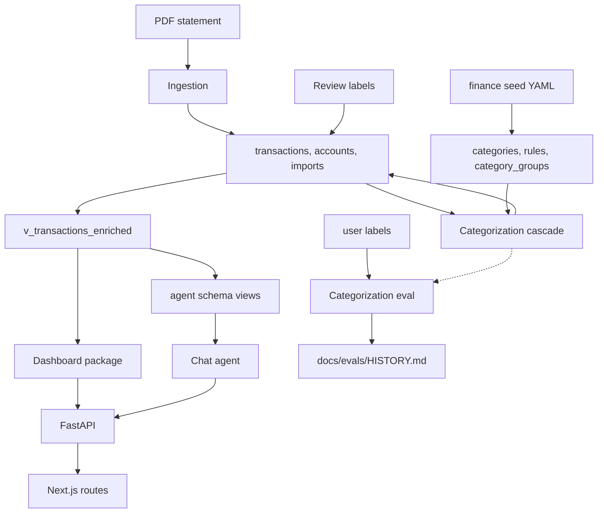

# System map

tally ai is a local single-user app. Python in `apps/api/finance` owns ingestion, categorization, the dashboard reads, the chat agent, and evals. Next.js in `apps/web` is the browser. Supabase Postgres is the ledger. What the product does and how to run it is in [README](../../README.md). Why each part is built this way is in [Architecture](../../docs/architecture.md). This page only says who owns a change. Code and tests win over both documents. Specs in `docs/superpowers/specs/` explain why; [Backlog](../../docs/backlog.md) is not built.

The money contract is [Money rules](../../docs/money-rules.md). Do not restate it. Column and view ownership is [Data model](data-model.md).

Owned systems and the data they hand off. The eval reads the production cascade as a dry run and does not write the ledger.

## How a statement becomes a number

1. `POST /imports` or `finance import` parses a BBVA or CaixaBank PDF, resolves the account by IBAN, and inserts rows. `on conflict (dedup_key) do nothing` makes a second upload of the same movement a no-op.
2. The same call schedules categorization in the background. The CLI runs it in the same process after the insert. Pairing and system rules always run. jev runs only when `TYPESAFE_API_KEY` is set and the caller did not pass `--rules-only`.
3. Saved categories, including user labels, flow into `v_transactions_enriched`. Dashboard SQL and the agent's `agent.transactions` view both read that view. A total that bypasses it will disagree with every page and the chat.
4. The browser never opens Postgres. Pages call the API at `NEXT_PUBLIC_API_URL` (default `http://localhost:8000`).

## Ingestion

Owner: `apps/api/finance/ingestion`.

`detect_adapter` sniffs the first page and dispatches to `BbvaPdfAdapter` or `CaixaBankPdfAdapter`. Anything else raises `UnsupportedStatement`. `import_statement` is the only writer of `accounts`, `imports`, and new `transactions`. It stores the file SHA-256, period, and new-versus-duplicate counts, then structures each line (bank concept, merchant text, card last four) before insert. The dedup key hashes IBAN, booking date, amount, description, printed balance, and the occurrence of that fingerprint in the file.

A new bank is a new adapter plus a `bank` enum value, not a change to the cascade. Import does not categorize. Callers do: the CLI after a successful insert, and `POST /imports` via `BackgroundTasks`.

## Categorization

Owner: `apps/api/finance/categorization`. The cascade, not the HTTP route, is the system.

`categorize_pending` is the production run. It pairs transfers, loads rows whose `category_source` is `none` (or every non-`user` row when `--all` / `?all=true`), then:

- A paired own-account transfer is `own_accounts` from the rule path. It never calls jev.
- An enabled system rule (`rules`, seeded from `supabase/seed/rules.yaml`) assigns its category. A refund rule only changes the category options jev sees.
- Everything else is one jev call with three typed questions: merchant fragment, level-2 category, subscription. Python then exact-matches merchants, merges at `merge_threshold` (0.8), lets a confirmed merchant default win, and derives level 1 from the level-2 probabilities.
- `needs_review` is set when the jev category confidence is under `category_threshold` (0.95) or merchant resolution dropped the name.

`save` refuses to overwrite `category_source = 'user'`. A row jev cannot answer stays pending. After save, `link_loans` attaches a loan row to the merchant of its contract number. One process-wide lock serializes background runs so two uploads cannot create the same merchant twice.

User decisions live in `labels.py`, not in the cascade. Labelling one transaction writes `category_source = 'user'` and a `transaction_labels` row. Confirming a merchant sets its default and relabels only rows still sourced `jev`, `merchant`, or `none`, then records those as user labels. That history is the golden set.

`finance seed` upserts `categories`, `category_groups`, and `rules` from `supabase/seed` and disables rules removed from the YAML. Migrations do not load that YAML.

## Dashboard

Owner: `apps/api/finance/dashboard`. It only reads.

Every aggregate goes through `v_transactions_enriched` with the shared `WHERE` in `filters.py` (period, accounts, type, group, category, merchant). `totals`, `month_series`, `cumulative`, `breakdown`, and `scope_months` are the reads. A month with no imported data is `has_data = false`, not zeros. `transactions.page` is the filtered list. `subscriptions` reads `v_subscriptions`.

Do not put categorization writes here. Do not recompute spend or income in the web app. `apps/web/src/lib` formats, filters, and lays out numbers the API already computed. KPI wording in `definitions.ts` is quoted from the money rules; change the rules first.

## Agent

Owner: `apps/api/finance/agent`.

`open_chat` is the lifecycle, used by the API lifespan and `finance chat`. It loads the YAML semantic layer, checks it against the live `agent` views, `EXPLAIN`s every metric and example, opens an `AsyncPostgresSaver`, and builds one `create_agent` ReAct loop whose only tool is `run_sql`. A missing `SUPABASE_DB_URL`, or an `xai:` model without `XAI_API_KEY`, yields `None`. Dashboard routes keep working; chat routes return 503.

`run_sql` is guarded twice. `sql_guard.check_query` allows one `SELECT` over `transactions` and `subscriptions` with no schema. `sql_runner` then runs it as `agent_reader` in a read-only transaction, `search_path = agent`, with `statement_timeout`. Failures return as tool data, not exceptions. The agent does not use jev. The v1 spec's router in front of the chat was not built.

Two stores stay separate. The checkpointer is the model's memory and is rewritten by summarization. `chat_threads` and `chat_messages` are what the UI lists, and that history does not shrink. A turn is one Langfuse trace. Thumbs up or down becomes a `user-feedback` score.

Change a metric or example in `agent/semantic/` and restart: startup rejects a view mismatch. Do not grant `agent_reader` anything beyond the `agent` schema.

## Evals

Owner: `apps/api/finance/evals`.

`finance eval-categorization` dry-runs the production cascade against the latest `source = 'user'` label of each transaction. It does not write categories, merchants, or defaults. It uses an empty roster and ignores merchant defaults, because those defaults come from the labels being scored. Pairing is computed in memory for the same reason.

One line is appended to `docs/evals/HISTORY.md`. Row-level output stays in git-ignored `eval-output/`. The golden set grew between history lines, and run-to-run noise is about ten rows. `finance labels export` / `import` moves that golden set as CSV keyed by `dedup_key`. Export keeps labels and notes, not merchant defaults.

## API

Owner: `apps/api/finance/api`. Routers are thin. They validate, open a request-scoped connection, and call the package that owns the behavior.

`main.py` mounts every router, applies CORS and `TrustedHostMiddleware`, and requires `same_origin` on unsafe methods that send an `Origin`. `GET /health` is the liveness check. The sync pool in `db.py` serves ingestion, categorization, and dashboard. The chat keeps its own async pool for the process lifetime.

| Prefix | Owner it calls | Role |
|---|---|---|
| `/imports` | ingestion, then categorization | Upload a PDF, list recent imports |
| `/categorize` | categorization | Queue another cascade run |
| `/review` | categorization | Inbox of `needs_review` rows, one card per merchant, plus merge suggestions |
| `/transactions` | dashboard reads, categorization writes | List, label one row, set a note |
| `/merchants` | categorization | List, rename or merge, confirm a default, dismiss a merge, set cadence |
| `/categories` | taxonomy tables | Read-only picker data and the slug check used by label routes |
| `/accounts` | `accounts` | List (last four of the IBAN only) and rename |
| `/dashboard` | dashboard | Overview and subscriptions |
| `/spending` | dashboard | One group, category, merchant, or income scope |
| `/chat` | agent | Threads, streamed turns, feedback |

`POST /imports` returns as soon as the insert commits. Categorization is a background task and must not fail the upload. `POST /categorize/run` only queues that same task.

## Web routes

Owner: `apps/web/src/app`. The shell nav is Overview, Transactions, Subscriptions, Chat, Review, Imports, Settings. Spending, income, and merchant pages are reached from those views, not from the nav.

| Route | Reads | Writes |
|---|---|---|
| `/` | `/dashboard/overview`, `/categories` | none |
| `/transactions` | `/transactions`, `/categories`, `/merchants` | label and note from the list |
| `/subscriptions` | `/dashboard/subscriptions` | cadence via merchant routes |
| `/spending/[group]` and `/spending/[group]/[category]` | `/spending/detail` | none on the page itself |
| `/income` and `/income/[category]` | `/spending/detail?type=income` | none on the page itself |
| `/merchants/[id]` | `/spending/detail`, `/merchants/{id}` | merchant default, rename, merge |
| `/chat`, `/chat/[id]` | `/chat/threads` and messages | stream via `useChat` to the thread messages route |
| `/review` | `/review`, `/review/count` | confirm, dismiss, label |
| `/imports` | `/imports` | PDF upload |
| `/settings` | `/accounts`, `/categories` | account rename only; categories are read-only |

`apps/web/src/lib/api.ts` is the JSON client. `chat-api.ts` is the only chat transport: AI SDK `useChat` posts the new question to the Python agent and renders the SSE stream. The agent does not run in the browser.

`reviewCount` and `filterContext` are called from the shell and time out at 2 seconds so a down API does not block every page. Chat layout turns a 503 into a setup message. Other API failures surface as page errors.

## Migrations

Owner: `supabase/migrations`, applied in timestamp order. The files are the schema. `finance seed` is the taxonomy.

| Migration | What it owns |
|---|---|
| `20260922000000_init.sql` | `bank` enum, `accounts`, `imports`, `transactions`, dedup unique key |
| `20260924000000_categorization.sql` | `categories`, `merchants`, `rules`, `transaction_labels`, categorization columns |
| `20260925100000_slice3.sql` | `note`, refund rule kind, `merchant_source = 'rule'` |
| `20260925110000_slice3_views.sql` | `v_transactions_enriched` and the aggregate views, including the first `v_subscriptions` |
| `20261012000000_slice4_chat.sql` | `agent` schema, `agent_reader`, `chat_threads`, `chat_messages` |
| `20261014120000_subscription_cadence.sql` | cadence on `v_subscriptions` and `agent.subscriptions` |
| `20261014130000_display_names.sql` | `category_groups`, display names, view replace that keeps the agent grant |

`supabase db reset` wipes labels, notes, and merchant defaults. After labels exist, export them first and apply new files with `supabase migration up`. The LangGraph checkpoint tables are not in these files; `AsyncPostgresSaver.setup()` creates them when the chat opens.

## What not to break

- User labels win. Cascade saves and `--all` both skip `category_source = 'user'`.
- Import and categorization are separate failures. A bad PDF is 422. A categorization exception is logged and does not roll back the import.
- One money view. Dashboard SQL and `agent.transactions` both start from `v_transactions_enriched`.
- The agent stays on `agent_reader`, one `SELECT`, no schema qualifier. Do not add a second tool or point it at `public`.
- Background categorization is single-flight in one API process. A second API process would not share that lock.
- `public` has no row-level security. This is a local app. Do not host it as-is.
- jev sees cleaned bank text and the amount. The chat model sees the question, the SQL, and the agent-view rows. Neither receives an IBAN or `description_raw`.

## Configuration

Repo-root `.env`, documented in `.env.example` and read by `get_settings`. `SUPABASE_DB_URL` is required for anything that touches Postgres. `TYPESAFE_API_KEY` enables jev; without it, pairing and rules still run and the summary says jev was skipped. `XAI_API_KEY` enables the chat. `LANGFUSE_*` is optional: tracing no-ops without keys. Chat knobs override as `CHAT__<FIELD>`.

CORS defaults to `http://localhost:3000`. Trusted hosts include `testserver` so API tests work. Do not print secrets; settings fields that hold them are excluded from `repr`.

## Verify

From `apps/api`: `uv run task test` (no database, no network), `uv run task lint`, and `uv run task test-integration` against local Supabase. Focused tests for this map: `test_importer.py` and `test_dedup.py` for ingestion, `test_categorizer.py` for the cascade, `test_views.py` and `test_dashboard_api.py` for the money read, `test_sql_guard.py` and `test_agent_graph.py` for the agent, `test_eval_run.py` for the dry run, `test_api.py` for the router mount.

UI flows are checked with agent-browser, not Playwright. Checks that write data use scratch-database recipe R2. Chat checks use scripted models and recipe R3. Both recipes are named in [CLAUDE.md](../../CLAUDE.md); do not invent their steps. How to run the checks is [Verify a change](../operations/verify-a-change.md).
