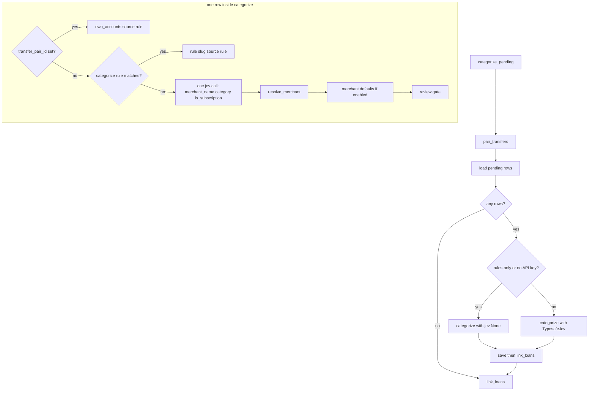

# Categorization cascade

A production run turns pending bank rows into categories, merchants, and a review queue. Pairing and system rules run first and never call jev. Everything else gets one jev call with three typed questions, then merchant resolution and merchant defaults. The review gate is the last decision, not a later job.

Change pairing, rules, questions, merchants, thresholds, or loans here. The surrounding contract is [Money rules](../../docs/money-rules.md). How a label lands in review is [Review and labels](../workflows/review-and-labels.md). How to score a change is [Run categorization eval](../workflows/run-categorization-eval.md). Tables written by a run are in [Data model](../architecture/data-model.md).

## Who starts a run

`categorize_pending` in `apps/api/finance/categorization/store.py` is the production entry. It always pairs first, loads pending rows, categorizes, saves, then calls `link_loans`.

| Entry | What it does |
| --- | --- |
| `POST /imports` | After a successful PDF import, queues `run_categorization_logged` for pending rows only. The import response does not wait for jev. |
| `POST /categorize/run` | Returns 202 and queues the same background function. `?all=true` re-runs every row whose `category_source` is not `user`. |
| `finance categorize` | Synchronous. `--all` is the same re-run. `--rules-only` never calls jev. |
| `finance import` | Imports every file, then calls `run_categorization()` once. A categorization exception is printed; the imports already succeeded. |

A missing `TYPESAFE_API_KEY` is the same as rules-only for the jev step: pairing and rules still run, the summary says `jev skipped: TYPESAFE_API_KEY is not set`, and unmatched rows stay `category_source = 'none'`.

## The cascade

One production run: pairing, then either a rules-only pass or the full cascade, then save and loan linking.

Pending means `category_source = 'none'`, ordered by `booked_at` then id. `--all` also includes `rule`, `merchant`, and `jev` rows, still excluding `user`. User rows are not loaded, so they are not sent to jev and not rewritten.

Inside `categorize`, a row with `transfer_pair_id` is `own_accounts` before any rule. Otherwise the first enabled `kind = categorize` rule that matches bank, direction, and field wins. Refund rules do not categorize; they only change the options jev sees. Pairing and rule rows never call jev and always come back, even when jev is `None`.

## Own-account pairing

`pair_transfers` runs before the categorizer, on the database, not on the in-memory pending list.

Candidates are unpaired rows whose `description_raw` matches `transfer_pattern` (default `TRASPASO|TRANSFER|BIZUM|TRF`, case-insensitive). A user-labelled row is a candidate only when its slug is already `own_accounts`, so a transfer marked before the other statement arrives can still pair.

`find_pairs` keeps one-to-one opposite amounts on different accounts, within `transfer_window_days` (default 2, inclusive). Globally nearest booking dates win. Same account, unequal amounts, card purchases, and rows outside the window do not pair.

Each pair gets a new `transfer_pair_id`. Sides that are not user-labelled are written as `tx_type = transfer`, `category_slug = own_accounts`, `category_source = rule`, confidence 1, `needs_review = false`, with merchant and subscription fields cleared, plus a `transaction_labels` row of source `rule`. A user `own_accounts` label is linked but not overwritten, and no rule history row is inserted for it. A second call finds nothing new because both sides now have a pair id.

Unpairing is not part of the cascade. Labelling a paired row as something other than `own_accounts` clears `transfer_pair_id` on both sides. The other side goes back to review unless it is user-labelled.

## System rules

Rules live in `supabase/seed/rules.yaml` and are loaded with `uv run finance seed`. Seed upserts by name and disables names no longer in the file. `load_rules` reads only `enabled` rows, ordered by name, so the first matching name wins. A bad regex, a categorize rule without a slug, or a refund rule with a slug fails at load.

A rule matches when its bank is null or equal, its direction is `any` or equal, and `re.search` (case-insensitive) hits `bank_concept` or `merchant`. Seed rules cover ATM withdrawals, credit-card settlements, loan disbursement and repayment, Bizum and person payments, and some own-account text. A shop purchase does not match. Changing a pattern changes both production and eval, because eval loads the same table.

A refund rule (`kind = refund`) never assigns a slug. On incoming money it makes `category_options` offer expense leaves instead of income leaves, so a card purchase coming back is categorized as an expense. Other incoming money still sees income plus transfer leaves. Outgoing options are expense plus transfer.

A rule result is confidence 1, source `rule`, and does not set `needs_review`. `tx_type` comes from the category, not the sign of the amount.

## One jev call, three questions

Unmatched rows are asked in parallel (`asyncio.gather`, `jev_concurrency` default 8). Each call is `jev.ask("categorize", state, first_call_questions(...))`.

`jev_state` sends `bank`, `bank_concept`, `merchant_text` (the structured merchant field, or empty), `amount` as a string, and `direction`. It does not send `description_raw`, so a card number that only lives in the raw line never reaches jev. Fragments also drop any token that contains a digit.

`first_call_questions` builds three independent questions. jev chooses; it does not invent strings.

| Question | Type | Options |
| --- | --- | --- |
| `merchant_name` | Choice | Every 1-to-4-word fragment of `merchant_text` that contains two letters in a row, plus `none`. |
| `category` | Choice | Direction leaves, or expense leaves when a refund rule matched. Criteria are `group`, `what`, and `not_for`. Display names are not sent. |
| `is_subscription` | Noul | "A recurring charge for a service the person can cancel." Not utilities, rent, mortgage, loan repayments, or one-off purchases. |

`TypesafeJev` maps those specs to SDK `Choice` and `Noul`, uses the SDK retry policy, and records one Langfuse generation per call under the run's `categorize` span. A missing request-id header is kept as `None`; the paid answer is not dropped.

A second jev call, `same_merchant`, happens only inside merchant resolution, and only for a new name that shares a significant word with a known merchant.

## Merchant resolution

After the first calls return, merchants are resolved one row at a time in `(booked_at, id)` order, not input order. The roster is not safe for concurrent `add` on one name: the same-merchant await sits between lookup and insert. Resolving in booking order means the earlier row creates the merchant the later row can reuse.

`MerchantRoster` keys names with `match_key`: uppercase, letters and digits only. `MC DONALD'S` and `MCDONALDS` are one merchant. The roster is loaded from `merchants` at the start of the run; new names stay in memory until `save`.

`resolve_merchant`:

1. Choice `none` or missing: no merchant, not dropped.
2. Exact key already in the roster: reuse it, even when brand confidence is below the new-name gate. No second call.
3. Brand confidence below `brand_threshold` (default 0.5): drop the name and set `dropped`. Brand confidence sums probabilities of fragments nested in the chosen name (`ACME` plus `ACME FOODS`), excluding `none`. The gate is inclusive at 0.5.
4. Otherwise shortlist known merchants that share a significant word (longer than two characters, not a legal suffix or filler such as `SL`, `SA`, `DE`). No overlap: create the merchant.
5. Shortlist hit: ask `known_merchant` over those names plus `none`.
   - Confidence `>= merge_threshold` (default 0.5): use the known merchant. Inclusive.
   - Confidence `>= merge_suggestion_floor` (default 0.3) and below the merge threshold: create a new merchant and record a merge candidate. Inclusive at 0.3.
   - Otherwise create a separate merchant. `test_merge_and_suggestion_thresholds_are_inclusive` locks 0.5 as a merge, 0.3 as a suggestion, and 0.29 as a separate merchant. Do not change those comparisons. The settings comment points at [eval history](../../docs/evals/HISTORY.md) (2026-10-17) for why 0.5 is the merge default. Lines in that file marked not kept are not the shipped default. Do not quote merchant names from its notes.

`save` inserts new merchants by `match_key` and writes `merge_candidate_id` only when the new merchant is not yet `confirmed`. A merchant deleted or merged in review while jev was answering is left out of the id map and recreated by name if a result still names it. A merge candidate that disappeared is dropped rather than written as a dangling id.

## Merchant defaults

`decide` starts from jev's category (`source = jev`) and subscription score. When `use_merchant_defaults` is true (production and rules-only; false only in eval) and the resolved merchant has a default:

- `category_slug` and `is_subscription` on the merchant replace jev. Category source becomes `merchant`. Confidence and level-1 confidence are cleared. The jev probability map is still stored, so review can show what jev would have picked.
- An income default does not apply to money out (`amount < 0` and the default's `tx_type` is `income`). The row keeps jev's category.
- A default applies in both directions otherwise, including a refund of that shop.
- A null `is_subscription` on the merchant leaves jev's score in place. That is how a merchant confirmed from incoming money behaves: the category default applies, the subscription flag does not.

Confirming a merchant in review writes that default and relabels existing rows whose source is `jev`, `merchant`, or `none`, except money-out rows when the new category is income. User rows are not relabelled. `clear_merchant_default` nulls the category and subscription flag so later rows go through jev again; existing labels stay.

Eval calls `categorize` with an empty roster and `use_merchant_defaults=False`, and computes pairs in memory. It does not write the database. A threshold or question change is scored there, not by re-running production against labels that already baked in defaults.

## Thresholds and the review gate

Defaults live on `Settings` and are read from the repo-root `.env` once. They are not hardcoded in `decide`.

| Setting | Default | Comparison | Effect |
| --- | --- | --- | --- |
| `category_threshold` | 0.95 | `confidence < threshold` | A `jev`-sourced category goes to review. Equal to 0.95 is accepted. |
| `subscription_threshold` | 0.7 | `noul > threshold` | Marks a subscription. Equal to 0.7 is not a subscription. |
| `brand_threshold` | 0.5 | `brand < threshold` | New name is dropped. Equal to 0.5 creates it. |
| `merge_threshold` | 0.5 | `same.confidence >= threshold` | Reuse the known merchant. Equal to 0.5 merges. |
| `merge_suggestion_floor` | 0.3 | `>= floor` and below merge | New merchant plus a reviewable merge suggestion. Equal to 0.3 suggests; 0.29 stays separate. |
| `transfer_window_days` | 2 | `days <= window` | Pairing window. |
| `jev_concurrency` | 8 | `ge=1` | Parallel first calls. Zero is rejected: a semaphore of 0 would block forever. |

`needs_review` is true only when the saved source is `jev` and category confidence is below 0.95, or the brand was dropped. A merchant default clears review even when jev was unsure. Rule and pairing rows are not reviewed. A subscription score never opens review by itself.

A subscription mark also requires `tx_type == expense` and `amount < 0`. Refunds and outgoing transfers are never subscriptions, even when noul is high or the merchant default says so.

`/review` lists rows with `category_source <> 'user' and needs_review`, plus unconfirmed merge suggestions as their own cards. Rows still at `category_source = 'none'` are counted as uncategorized, not as category cards. Confirming a label or a merchant sets `needs_review = false`.

## Loans

`link_loans` runs after save, including on an empty pending list and on a rules-only or skipped-jev run. It does not call jev.

It selects rows whose slug is `loan_received` or `loan_payment` and whose `merchant_id` is null. The contract pattern is BBVA's `4-4-2-10` digit form. The merchant name is `Loan ····` plus the last four digits. If another loan row of the same contract already has `merchant_source = 'rule'`, that merchant is reused, so a loan the user renamed keeps later instalments. Otherwise the name is created. The update sets `merchant_source = 'rule'` and does not change the category.

`save` preserves a `merchant_source = 'rule'` merchant across re-categorization. An `--all` run that re-applies the loan rule therefore does not wipe the contract merchant.

## Failure isolation and the run lock

One bad jev row does not fail the run. `asyncio.gather(..., return_exceptions=True)` keeps going. A failed first call, a failed `same_merchant` call, or a malformed answer (unknown slug, missing confidence) is logged as a warning with the transaction id and the exception repr (`%r`) — never the jev state or the description — and that id is omitted from results. `save` writes the rest. The omitted row stays `category_source = 'none'` and is pending on the next run. Pairing and rule rows are already in the result map, so they are saved even when every jev call fails.

`failed` on the summary is `len(rows) - len(results)` for a jev run, and 0 for rules-only. Cancellation is re-raised: it is not treated as a per-row failure.

Background runs (`run_categorization_logged`) hold a process-local `threading.Lock`. Overlapping imports would otherwise ask jev twice about the same rows and race merchant creation. The lock is one process only. A failure inside the locked run is logged and swallowed so an import's background task cannot fail the request. CLI `finance categorize` does not take the lock.

`save` also refuses to overwrite a user label that arrived while jev was answering: the update requires `category_source <> 'user'`, and a zero rowcount skips label history. That is the second guard, after the pending query.

## What not to break

- Do not send `description_raw` to jev, and do not log jev state. Card numbers stay in the database; review masks them on the way out.
- Do not write `category_source = 'user'` from the cascade. User labels are the golden set. Eval reads the latest user row in `transaction_labels`.
- Do not apply an income merchant default to money out, and do not mark a refund or a transfer as a subscription.
- Do not resolve merchants concurrently on one roster. Booking order is the duplicate-prevention mechanism.
- A new threshold comparison must match the existing edges: category and brand are inclusive at the accept/create boundary; subscription is strict greater-than; merge is inclusive at 0.5 and the suggestion floor is inclusive at 0.3.
- Rules-only and a missing API key must still pair, apply rules, and link loans. They must not call jev.
- Loan merchants are `merchant_source = 'rule'`. A re-save that clears that case will drop renamed loans on the next `--all` run.

## Focused tests

Unit tests construct `CategorizationContext` from seed YAML and `Settings()` defaults, and use `FakeJev`. Integration tests use synthetic dates before 2000 so they do not compete with a real ledger, and they refuse a real `TypesafeJev`.

| Change | Test |
| --- | --- |
| Pairing window, one-to-one, user labels | `apps/api/tests/test_pairing.py` |
| Seed rules and refund rules | `apps/api/tests/test_rules.py` |
| Cascade, defaults, thresholds, per-row jev failure | `apps/api/tests/test_categorizer.py` |
| Fragments and the three questions | `apps/api/tests/test_jev_questions.py` |
| Brand, merge, and suggestion edges | `apps/api/tests/test_merchants.py` |
| Save, pending retry, rules-only, lock | `apps/api/tests/test_store.py` |
| Contract merchant and rename survival | `apps/api/tests/test_loans.py` |

`uv run task test` from `apps/api` covers the unit files. Pairing, store, and loan integration tests need the scratch database; CLAUDE.md names recipes R2 and R3.
