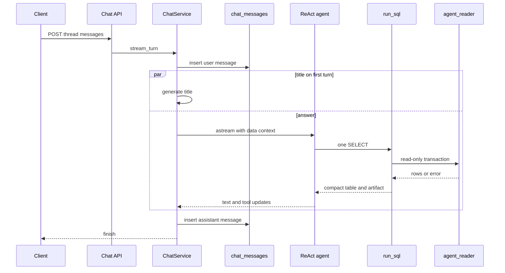

# Chat agent

The chat answers questions about the household's own imported bank data. It is one LangChain ReAct agent built with `create_agent`, and it has one tool, `run_sql`. There is no router in front of it. The v1 spec's section 9 (a jev router and a `describe_schema` tool) was superseded by [slice 4, section 16](../../docs/superpowers/specs/2026-10-12-slice-4-chat-design.md). Do not add that router back.

The agent never writes. It reads two views in schema `agent`, as the `agent_reader` role, inside a read-only transaction. What those views mean in money is [Money rules](../../docs/money-rules.md). Which objects own the columns is [Data model](../architecture/data-model.md). How a question reaches this agent from the web is [Ask a question](../workflows/ask-a-question.md). Knobs live in [Configuration](../operations/configuration.md).

Three things are not built. Chat evals, a check that every stated amount appeared in a query of the turn, and account balances are ideas in [Backlog](../../docs/backlog.md) (items 6, 8, and 5). Do not describe them as existing, and do not widen `agent_reader` so the agent can reach balances or other tables.

## What one turn does

`open_chat` is the process entry. The API lifespan in `apps/api/finance/api/main.py` stores the yielded `ChatService` on `app.state.chat`. `finance chat` uses the same context manager, so the CLI and the web share threads. If `SUPABASE_DB_URL` is missing, or the configured model is `xai:` and `XAI_API_KEY` is missing, `open_chat` yields `None`. Dashboards keep working. Chat routes answer 503.

Startup then fails closed. It loads the YAML, checks it against the live `agent` views, and `EXPLAIN`s every metric and example as `agent_reader`. A mismatch raises `SemanticLayerError` and the API does not start. It also creates the LangGraph checkpoint tables (`AsyncPostgresSaver.setup()`, idempotent) and binds one `run_sql` tool. The checkpointer uses strict msgpack (`allowed_msgpack_modules=None`).



One turn, from the message route to the saved answer. The title task runs only when the thread has no title yet, and it does not block the first model call.

`stream_turn` refuses a second turn or a delete on a thread already in `active` (`ThreadBusy`, HTTP 409). The turn runs in its own task and hands AI SDK parts over a queue. The user message is inserted before the agent runs. On the first turn, a title task runs beside the answer and stores a title only if `title_source` is still null, so a user rename wins. Title failure falls back to the question text. It is cosmetic.

The agent stream is `astream` with `stream_mode=["messages", "updates"]` and `version="v2"`. `ui_parts` turns model text into `text-delta`, a `run_sql` call into `tool-input-available`, and the artifact into `tool-output-available`. History rewrites (summarization, the dangling-call repair) carry `RemoveMessage` and are not streamed again. The HTTP response is `text/event-stream` with `x-vercel-ai-ui-message-stream: v1`. FastAPI's `EventSourceResponse` is not used because it drops that header.

Cancellation of the generator (the client left or stopped) cancels the turn task. The relay shields the wait so that cancellation does not land a second time inside the save. The partial answer is stored as `stopped`. An exception is stored as `error` with the fixed text `Something went wrong while answering. Try again.` A database the turn cannot reach uses `I can't reach your database right now. Try again in a moment.` and is also `error`. Either way the thread is released, so the next question can run. A client that never reads the stream still gets a saved answer.

## The agent

`build_agent` calls `create_agent` with the agent model, the single tool, the middleware stack, `context_schema=AgentContext`, and the checkpointer. `AgentContext` holds only the data-context string. It is passed on each `astream` and is not stored in the checkpoint. The system message is built on every model call and is also absent from the stored thread, so a prompt edit does not rewrite old checkpoints.

Three models come from `ChatSettings` through `init_chat_model`:

| Role | Default | Notes |
| --- | --- | --- |
| Agent | `xai:grok-4.7`, reasoning `high` | `reasoning_effort` is passed to providers that accept it |
| Summary | `xai:grok-4.7`, reasoning `medium` | Compacts old turns |
| Title | `xai:grok-4.20-non-reasoning` | Structured `ChatTitle`; provisional |

`max_retries` (default 2) is the client retry on 429 and 5xx. Override any field from `.env` as `CHAT__<FIELD>`.

### Instructions and data context

`prompts/system.md` is static. It names no table, and of the money columns it names only `spend`, `income`, and `amount`. The data model arrives as the data context, so a view change rarely touches the prompt, and a prompt change does not break a stored thread.

Rule priority, when two rules conflict: data integrity, then money rules, then numeric correctness, then clarity, then style. The workflow the model is told to follow is lookup, then one final query. A filter value must be an allowed value or the result of a lookup. Totals, shares, averages, and deltas are computed in SQL. Every number in the answer is supposed to come from a `run_sql` result of this turn, because earlier results may have been cleared. That is a prompt rule, not a code check. Backlog item 8 exists because a live run stated an amount no query returned.

`render_data_context` rebuilds the second system block every turn: model knowledge and columns with live Postgres types, allowed values, metric expressions, the twelve examples, today's date, and the latest imported movement. Category and group values come from `categories` (seed order) plus the synthetic `uncategorized`. Account values come from `accounts` joined to `imports` coverage. Merchants, notes, bank text, and bank operations have no value list. The model must look them up.

`PROMPT_VERSION` is a 12-character hash of `system.md` plus `prompts/summary.md`. `layer_version` is a 12-character hash of the semantic YAML. Both are recorded on the Langfuse trace (`version` and metadata `semantic_layer`). Prompts stay in git. Langfuse prompt management is not used.

### Middleware

`build_middleware` stacks, in order:

1. `close_dangling_tool_calls`. A stopped turn can leave a tool call without a result. Providers reject that history. Before the next turn, each unanswered call gets a `ToolMessage` saying the user stopped the answer.
2. `SummarizationMiddleware`. Triggers at `summary_trigger_tokens` (150,000) and keeps `summary_keep_messages` (20). `trim_tokens_to_summarize` is `None` so the default trim cannot drop the previous summary. The summary prompt tells the model that figures in the summary are context only and must be queried again.
3. `ContextEditingMiddleware` with `ClearToolUsesEdit`. Old tool results are replaced by `[result cleared: run the query again if you need these numbers]` once the trigger (15,000 tokens) is passed, keeping the last 4. The SQL of the call stays.
4. `ToolCallLimitMiddleware` on `run_sql`, `run_limit` 8, `exit_behavior="continue"`. The model is told not to call the tool again and answers with what it has. The stream marks `hit_sql_limit`.
5. `ModelCallLimitMiddleware`, `run_limit` 12, `exit_behavior="end"`. The user sees a fixed narrower-question sentence. The checkpoint keeps LangChain's own limit text.
6. `stop_on_infra_error`. If the latest tool artifact has `infra_error`, the turn ends with the fixed unreachable-database message. Another model call would not heal it.
7. `system_prompt`. Joins the static instructions and the per-turn data context as two text blocks, instructions first so the provider can cache them.

`recursion_limit` (120) is a graph backstop, not the limit a turn should meet. A query costs about seven graph steps. `max_model_calls_per_turn` must stay above `max_sql_calls_per_turn`.

## The read-only SQL boundary

`run_sql` is the only tool. Its docstring tells the model it may run one PostgreSQL `SELECT` over the views `transactions` and `subscriptions`. The tool returns a compact table to the model and the full `QueryResult` as the artifact. The model sees at most `sql_rows_shown` rows (50) and `sql_max_chars` characters (8,000), and is told when the table was cut. The artifact, which the UI and `chat_messages` keep, holds up to `sql_row_limit` rows (200). Cells are plain text: decimals without exponent notation, ISO dates, `true`/`false`, empty for NULL.

### Guard

`check_query` is the early failure, with a reason and a hint the model can act on. It parses with sqlglot (`read="postgres"`) and walks the tree. It does not scan raw text, so a search for `%drop%` still passes.

It rejects:

- anything other than exactly one statement, and any root that is not a query
- write, DDL, `SET`, `LOCK`, `COPY`, and `INTO` nodes anywhere in the tree, including a `DELETE` hidden in a CTE
- a table that is not `transactions`, `subscriptions`, or a CTE in that query, and any schema-qualified table
- functions whose names start with `set_config`, `pg_sleep`, `dblink`, `pg_read`, or `lo_`
- a schema-qualified function call
- an unknown function, unless it is the allowlist `age` or `make_date`

The unknown-function rule is the barrier for built-ins that run SQL from a string (`query_to_xml`, `ts_stat`). A session can reset its role with `set_config` from that string. Standard functions sqlglot already types (`SUM`, `date_trunc`, `to_char`, and the rest) pass. Trailing semicolons and the spaces between them are stripped. A query that ends in a line comment still runs.

### Role and transaction

The guard is not the guarantee. `agent_session` takes a pooled connection and, inside a transaction that is always rolled back:

```sql
SET TRANSACTION READ ONLY;
SET LOCAL ROLE agent_reader;
SET LOCAL search_path = agent;
SET LOCAL statement_timeout = '<sql_timeout_seconds * 1000>';
```

`agent_reader` is `NOLOGIN`. The slice 4 migration grants it `USAGE` on `agent` and `SELECT` on the views, and grants the role to the migrating user with `SET` and `INHERIT false`. Later views that are dropped and recreated must grant `SELECT` again. A view replaced in place keeps the grant. There is no second database URL.

The executor wraps the cleaned SQL as `SELECT * FROM (<query>) AS result LIMIT <row_limit + 1>` and sets `truncated` when the extra row exists. A `QueryCanceled` comes back as "the query took longer than N s", not as an outage. Postgres errors become a `QueryResult` with a hint, never an exception, so a tool call always gets an answer and a thread is never left with an unanswered call. Connection failures (`PoolTimeout`, SQLSTATE class `08` or `57P`, or no SQLSTATE) set `infra_error`. Resource, limit, and lock errors do not. They ask the model to aggregate more or narrow the period.

A write that bypasses the guard still fails. The integration test sets the role back to `postgres` with `set_config` and then `INSERT`s. The read-only transaction raises `ReadOnlySqlTransaction`. `agent_reader` also cannot `SELECT` from `public` tables (`InsufficientPrivilege`). Do not grant the role more to "fix" a question the views cannot answer. Change the view, or leave the question unanswered.

## What the agent can see

Schema `agent` is not exposed by the Supabase Data API. The views are thin projections. Money rules stay in `v_transactions_enriched`. Not exposed: ids, raw bank descriptions, IBANs, `transfer_pair_id`, and confidences.

`agent.transactions` projects `booked_at`, `month`, `account`, `bank`, `amount`, `direction`, `tx_type`, `spend`, `income`, `category`, `category_group`, `merchant`, `bank_text`, `bank_operation`, `note`, `is_subscription`, `needs_review`, `category_name`, and `group_name`. `category` and `category_group` coalesce to `uncategorized`, which is not the category `uncategorized_expense`. Display names were added by [display names](../../supabase/migrations/20261014130000_display_names.sql). The model filters on the slug and says the display name.

`agent.subscriptions` was recreated by [subscription cadence](../../supabase/migrations/20261014120000_subscription_cadence.sql): `merchant`, `charges`, `last_charge`, `latest_amount`, `cadence`, `cadence_source`, `monthly_equivalent`, `active`. Cadence is the merchant's own value when set (`cadence_source = 'user'`), otherwise the median gap. Active is measured from the latest imported movement, not from today. The slice 4 spec's subscription column list (`typical_amount`, no cadence source) is stale. Trust the migration and `tests/test_agent_views.py`.

Balances are absent on purpose. `balance_after` exists on the ledger, but the order of movements within a day is not stored, so a balance on a date could pick the wrong row. That is backlog item 5, not a grant to add.

## Semantic layer

Files in `apps/api/finance/agent/semantic/` are the agent's knowledge. They are reviewed in pull requests. Pydantic models forbid extra keys, so a typo fails to load.

| File | Holds |
| --- | --- |
| `transactions.yaml`, `subscriptions.yaml` | One model each: description, grain, `use_for`, `not_for`, attributes |
| `metrics.yaml` | Named SQL expressions |
| `examples.yaml` | Twelve questions, each with what it teaches and SQL steps |

Any other `*.yaml` in that directory is loaded as a model, in stem order. `metrics` and `examples` are reserved stems.

An attribute `kind` is `measure`, `dimension`, `time`, `text`, or `flag`. Only a dimension may carry `allowed_values`, either a YAML list (`value`, `meaning`) or a source name: `accounts`, `categories`, or `category_groups`. The Postgres type is never written in YAML. `check_layer` requires a two-way match: every attribute is a column of the `agent` view, every column is described, and every metric names a known model.

`validate_layer` then compiles SQL. Each metric is checked as `SELECT <sql> FROM <model>`. Each example step is checked as written. Both must pass `check_query` and `EXPLAIN` as `agent_reader`. The API does not start if any step fails. That is the safe-change gate.

Shipped metrics, all on `transactions`: `expenses` is `SUM(spend)`, `income` is `SUM(income)`, `savings` is `SUM(income) - SUM(spend)`, `savings_rate` is that difference over `NULLIF(SUM(income), 0)`, and `net_cash_flow` is `SUM(amount)`. The rate is computed after summing. It is not a column to average. `net_cash_flow` includes transfers and is not spending. Do not invent a second definition here. If the money rule changes, change `v_transactions_enriched` and then the expression that sums it.

Examples teach a pattern. They are not a closed catalog and not templates to copy. Merchants and notes in them are made up. A lookup step comes before the final query when the filter is not an allowed value.

## Memory versus the history the user sees

Two stores, deleted together:

| Store | Owner | What it is |
| --- | --- | --- |
| LangGraph checkpoint | `AsyncPostgresSaver`, thread id is the chat thread id | Agent memory. Summarization rewrites it. Not in the app migrations. Created by `setup()` on startup. |
| `chat_threads`, `chat_messages` | `finance.agent.store` | What the user sees. History never shrinks. `ON DELETE CASCADE` from thread to messages. |

`chat_messages` keeps role, content, the query artifacts, status (`ok`, `error`, `stopped`), thumbs (`up` or `down`), and the Langfuse trace id. Reload reads this table, not the checkpoint. `delete_thread` removes the rows and calls `checkpointer.adelete_thread`. A send during that delete gets `ThreadBusy`, not a new turn whose checkpoint the delete would then drop.

The first message of a thread generates a title (`model` or `fallback`). `PATCH` sets `title_source` to `user`. A later generated title is stored only while `title_source` is null.

## Tracing

Each turn opens one Langfuse observation named `chat-turn`, type `agent`, inside the turn task. `propagate_attributes` sets `session_id` to the thread id, `user_id` to `chat.user_id` (default `local`), tag `chat`, and `version` to `PROMPT_VERSION`. Metadata carries the semantic-layer hash, the model, and the reasoning effort. Model calls, `run_sql`, and the summary nest under that trace through one `CallbackHandler`. The title is a separate `chat-title` run in the same session.

Scores written after the save, when a trace id exists: `sql_calls`, `sql_errors`, `hit_sql_limit`, `stopped`, `infra_error`. A failed turn is observation level `ERROR`. A turn that hit the SQL limit but still answered is `WARNING`. Thumbs become one `user-feedback` score per answer (`score_id` is the message id plus `-feedback`), so a second click replaces it. Without Langfuse keys nothing is recorded. The LLM and Langfuse receive questions, SQL, and query results. They do not receive IBANs or raw bank descriptions, because those columns are not on the views.

## Change a metric or an example

1. Edit `metrics.yaml` or `examples.yaml` only. Keep one statement per step. A lookup stays a separate step from the aggregate.
2. Use only `transactions` and `subscriptions`, with no schema, and only columns those views expose. Follow [Money rules](../../docs/money-rules.md): spending is `SUM(spend)`, income is `SUM(income)`, rates are computed after summing.
3. Stay inside the guard. One `SELECT`, no writes, no `set_config`, no schema-qualified functions, no function outside the ones sqlglot types plus `age` and `make_date`.
4. If the expression needs a new column, add it to the `agent` view in a migration and describe it in the model YAML in the same change. Do not grant `agent_reader` the base table. A recreated view needs `GRANT SELECT` again.
5. Start the API, or run the integration check. `validate_layer` refuses to boot on a mismatch or an `EXPLAIN` failure. `uv run task test` covers the guard and the YAML shape. `uv run task test-integration` runs `tests/test_catalog_db.py`, `tests/test_agent_views.py`, and `tests/test_sql_runner_db.py`.
6. A prompt change is a different edit (`prompts/system.md` or `prompts/summary.md`). It bumps `PROMPT_VERSION` and does not rewrite checkpoints. It also does not prove the model will state only queried numbers. There is no chat eval harness yet ([Backlog](../../docs/backlog.md) item 6).

A column rename that skips the YAML fails startup with `not a column` or `not described`, listing every mismatch. A metric pointed at an unknown model fails `check_layer`. A metric or example that does not compile fails with `semantic layer SQL does not compile`.

## Focused tests

| Test | What it locks |
| --- | --- |
| `tests/test_sql_guard.py` | CTE `DELETE` rejected, `%drop%` allowed, unknown tables and functions rejected, allowlisted `age` and `make_date` pass |
| `tests/test_sql_runner.py` | Error class to hint, timeout versus outage, cell formatting |
| `tests/test_sql_runner_db.py` | Role is `agent_reader`, base tables denied, write fails after a role escape, `query_to_xml` never reaches the database |
| `tests/test_semantic_layer.py` | Five metrics, twelve examples, two-way column check, YAML typo, example steps pass the guard |
| `tests/test_catalog_db.py` | Live views match the YAML and every metric and example `EXPLAIN`s |
| `tests/test_agent_views.py` | Exact column lists, money rules, `agent_reader` cannot read `public.accounts` |
| `tests/test_agent_graph.py` | One tool loop, dangling calls closed, infra stop, SQL limit continues, cleared results, system message not checkpointed |
| `tests/test_chat_service.py` | Save, 409 while busy, stopped answer, delete drops the checkpoint, outage leaves the thread usable |
