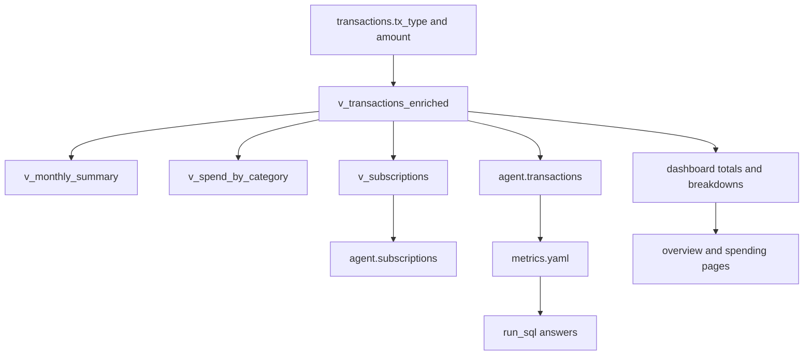

# Money rules

[Money rules](../../docs/money-rules.md) is the contract. Every dashboard number and every chat answer is supposed to follow it. This page does not restate the rules or their examples. It says which object applies them, which callers only sum that object, and what breaks if a new total does not.

The rules live in one SQL view, `v_transactions_enriched`. Subscriptions are a second view, `v_subscriptions`, which only groups flagged rows of the first. Python and the agent do not re-derive spend or income. They sum columns the view already computed.

How a row gets the `tx_type` those columns read is [Categorization cascade](categorization-cascade.md). Which migration owns each view is [Data model](../architecture/data-model.md). How the chat is allowed to read the projection is [Chat agent](chat-agent.md).

## One definition

`spend` and `income` are defined only in `v_transactions_enriched`. The current view is the slice 3 definition plus display-name columns appended by `CREATE OR REPLACE` in [display names](../../supabase/migrations/20261014130000_display_names.sql):

- `spend` is `-amount` when `tx_type = 'expense'`, otherwise 0.
- `income` is `amount` when `tx_type = 'income'`, otherwise 0.
- A transfer is 0 in both columns.
- `direction` is the sign of `amount`. It is not the type. A refund is incoming and still an expense, so its `spend` is negative.
- `month` is `booked_at` formatted as `YYYY-MM`.

The view joins `accounts`, `categories`, `merchants`, and `category_groups`. It does not filter. A row with no category still appears; `level1` is null until something categorizes it.

`tx_type` is a stored column, not recomputed in the view. Import writes it from the sign: `amount > 0` is `income`, otherwise `expense` (`transaction_rows` in `apps/api/finance/ingestion/importer.py`). Categorization and user labels then set it from the category: `Taxonomy.tx_type_of` returns `categories.tx_type`, and the label SQL copies `c.tx_type` onto the row. Until that happens, an uncategorized row keeps the import sign, which is why it still has spend or income. A later total that looks at `amount` or `direction` instead of `tx_type` will count a refund as income and a transfer as spending.

Slice 3 also creates `v_monthly_summary` and `v_spend_by_category`. Both group `v_transactions_enriched`. The dashboard does not query them. They are the SQL form of the contract, and `tests/test_views.py` locks them. Do not add a third definition beside them.

One ledger classification, then only sums. The two summary views are locked by tests; the live readers are the dashboard queries and the agent projections.

## What the dashboard sums

Dashboard reads share one filter fragment, `WHERE` in `apps/api/finance/dashboard/filters.py`, written against `v_transactions_enriched`. `Scope` carries accounts, type, group, category, and merchant. An empty account list means every account.

| Reader | What it sums | What it does not do |
| --- | --- | --- |
| `totals` | `sum(income)` and `sum(spend)` over the view, then savings and `savings_rate` in Python | Does not reclassify rows |
| `month_series`, `cumulative`, `scope_months` | The same columns, grouped by month, day, or child | Does not treat a missing month as zero |
| `breakdown` | `sum(spend)` or `sum(income)` by group, category, or merchant | Does not invent a type from the sign |
| Transaction explorer | The view, for listing and for money in, money out, and transfer volume | Transfer volume is `abs(amount)` of `tx_type = 'transfer'`, not spend |

`GET /dashboard/overview` calls `totals` with no type filter, so income, expenses, and savings include every row the view already classified. Group, category, and merchant charts call `breakdown` with `tx_type = 'expense'`, so they are spend charts. `GET /spending/detail` uses the same `totals` function and then picks `expenses` or `income` from the result. `GET /dashboard/subscriptions` does not sum the ledger; it reads `v_subscriptions`.

Savings rate is `savings_rate` in `apps/api/finance/dashboard/periods.py`: savings divided by income, `None` when income is not positive, rounded to four decimal places. It runs after the accounts are summed. Do not store a rate on the row and average it.

### Comparisons and empty months

Period comparison, including how a previous period is cut and when a month is "no data" rather than zero, is the Comparisons section of [Money rules](../../docs/money-rules.md). Do not restate it. `resolve_request` in `apps/api/finance/api/periods.py` applies that contract around the same sums. A chart that fills a missing month with 0 contradicts the contract even if it sums the view.

## Subscriptions

`v_subscriptions` was recreated by [subscription cadence](../../supabase/migrations/20261014120000_subscription_cadence.sql). It reads `v_transactions_enriched` and emits one row per merchant. Cadence, the latest charge, and the active window are the Subscriptions section of [Money rules](../../docs/money-rules.md). Do not restate them, and do not reimplement them in the page handler. `PATCH /merchants/{merchant_id}/cadence` writes `merchants.cadence`; null clears it. The merchant profile left-joins the view, so a merchant with no flagged charges has null cadence fields rather than a list row. Change the view, then check `agent.subscriptions`, which is a projection of it.

## What the agent sums

The chat never reads `public` views. Schema `agent` holds two projections, and `run_sql` runs as `agent_reader` with `search_path = agent`.

`agent.transactions` selects `spend`, `income`, `tx_type`, and `direction` from `v_transactions_enriched`. It coalesces a missing category to the text `uncategorized`. That is not the category slug `uncategorized_expense`. `agent.subscriptions` selects the subscription view and renames `merchant_name` to `merchant`. Ids, raw statement lines, and IBANs stay off both projections. See [Data model](../architecture/data-model.md) for the grant and the drop-versus-replace rule.

The metric definitions are [metrics.yaml](../../apps/api/finance/agent/semantic/metrics.yaml). Each `sql` is a fragment the model is told to use as-is:

| Metric | SQL | Model |
| --- | --- | --- |
| `expenses` | `SUM(spend)` | `transactions` |
| `income` | `SUM(income)` | `transactions` |
| `savings` | `SUM(income) - SUM(spend)` | `transactions` |
| `savings_rate` | that difference over `NULLIF(SUM(income), 0)` | `transactions` |
| `net_cash_flow` | `SUM(amount)` | `transactions` |

`net_cash_flow` is the one metric that sums `amount`. The description says it includes transfers and is not a measure of spending. The system prompt repeats the same split: spending uses `spend`, income uses `income`, and rates are computed after summing. [transactions.yaml](../../apps/api/finance/agent/semantic/transactions.yaml) tells the model never to `SUM(amount)` for spending or income.

Startup is the check that this stays true. `open_chat` calls `validate_layer`, which `EXPLAIN`s `SELECT <sql> FROM <model>` for every metric, and every example step, as `agent_reader`. A metric that names a column the projection does not have prevents the API from starting. Column lists are checked by `check_layer` against `information_schema` for schema `agent`. Changing the view without the YAML, or the YAML without the view, fails that check.

## What a bypass breaks

A new total that selects `transactions.amount`, or sums `direction`, has its own money rules. Dashboards and chat then disagree, and a category change no longer moves the number the contract says it should. The failure cases are [Money rules](../../docs/money-rules.md). Do not restate them.

A chat metric that is not in `metrics.yaml`, or that the projection does not expose, fails `EXPLAIN` at startup. If you skip that check and query `public` from the tool, you also widen what `agent_reader` can see. Do not grant it `public`.

The safe extension is a new column on `v_transactions_enriched` (or a view that only aggregates it), then a projection column if chat should see it, then a metric or attribute in the semantic YAML. `CREATE OR REPLACE VIEW` can only append columns. A reorder or drop needs a new `GRANT SELECT` to `agent_reader`. [Data model](../architecture/data-model.md) has the migration order.

## Tests that lock the contract

These are integration tests against the views, not unit tests of the prose in `docs/money-rules.md`.

| Test | What it locks |
| --- | --- |
| `tests/test_views.py` `test_monthly_summary_follows_the_money_rules` | January 1999 fixture: income 2000.00, expenses 455.00, savings 1545.00. February fashion refund of 30.00 is expenses −30.00. Transfers stay out. |
| `test_spend_by_category_nets_refunds_and_keeps_uncategorized` | Same fixture, net spend by category, including `uncategorized` 10.00. |
| `test_enriched_rows_carry_spend_income_and_note` | A money-in fashion row has spend −80.00, income 0, direction incoming. |
| Subscription tests in the same file | The subscription view against [Money rules](../../docs/money-rules.md): cadence, a user cadence, and the active window. Do not restate those rules here. |
| `tests/test_taxonomy.py` | `tx_type_of` follows the category, including a money-in expense category. |
| `tests/test_semantic_layer.py` and `tests/test_catalog_db.py` | Metric names, and `validate_layer` against the live `agent` views. |

The January fixture is `tests/money_month.py`. Use those amounts. Do not paste personal figures into a new test or into this page.

`uv run task test-integration` runs the view tests. After a view change, also run the API so `validate_layer` executes; a column mismatch is a startup failure, not a skipped example.
