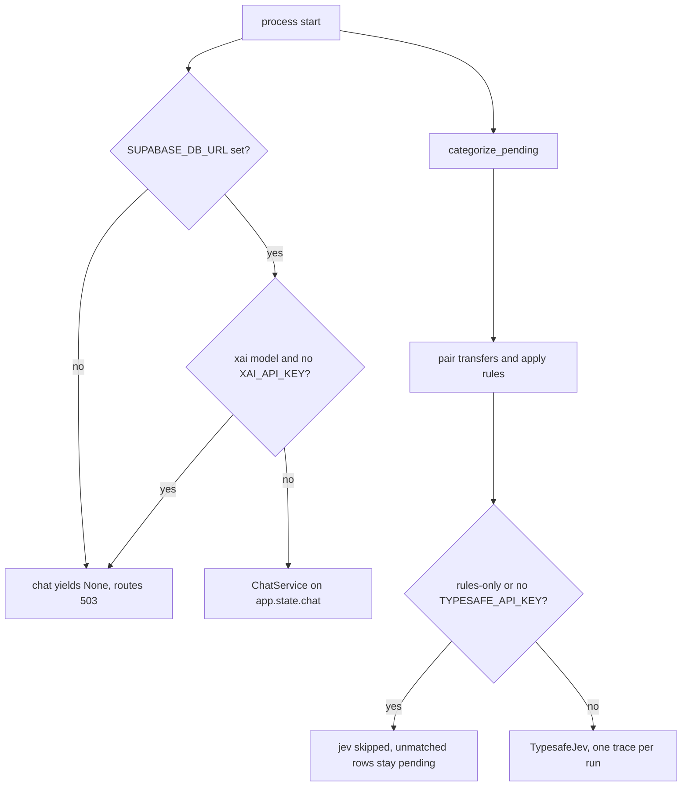

# Configuration and tracing

Settings are one cached `Settings` object, read from the repo-root `.env` (four parents above `apps/api/finance/settings.py`). Unknown keys are ignored. Nested chat fields use the delimiter `__`, so `CHAT__REASONING_EFFORT` sets `settings.chat.reasoning_effort`. Copy [`.env.example`](../../.env.example) to `.env`. Name keys in docs and logs. Never print, invent, or quote secret values.

[Privacy](../../docs/architecture.md#privacy) and [Limits](../../docs/architecture.md#limits) stay in the architecture doc. Link them. Do not copy either section. Limits mentions linked issues that are not built. Do not present those issues as implemented. The outbound boundary is the code, not that prose: `jev_state` does not send `description_raw`, and the agent views do not expose IBANs or `description_raw`. How these knobs change a categorization run is [Categorization cascade](../concepts/categorization-cascade.md). How they bound a chat turn is [Chat agent](../concepts/chat-agent.md). How to check a settings change is [Verify a change](verify-a-change.md).

## What is a secret

Five fields are `repr=False`: `supabase_db_url`, `typesafe_api_key`, `xai_api_key`, `langfuse_public_key`, and `langfuse_secret_key`. A failing assert or a log of `Settings` must not show their values. `test_repr_never_shows_secrets` constructs a `Settings` with `_env_file=None` so the developer's real `.env` is not loaded into that check.

| Env key | Required for | If unset |
| --- | --- | --- |
| `SUPABASE_DB_URL` | Every database call, including dashboards | Pools raise `SUPABASE_DB_URL is not set`. Chat startup logs `chat disabled` and yields `None`. |
| `TYPESAFE_API_KEY` | jev categorization and `finance eval-categorization` | Production categorization still pairs and applies rules, then skips jev. Eval refuses to start. |
| `XAI_API_KEY` | An `xai:` chat model | Chat is disabled. Other API routes keep working. |
| `LANGFUSE_PUBLIC_KEY` and `LANGFUSE_SECRET_KEY` | Recording traces | The SDK logs one warning and the client records nothing. Categorization and chat still run. |
| `LANGFUSE_BASE_URL` | Where traces go | Default `https://cloud.langfuse.com`. This is not a secret, but it is where observations are sent when keys are set. |

`langfuse()` copies those three values into `os.environ` with `setdefault` only when they are non-empty, because the SDK reads `LANGFUSE_*` itself. `open_chat` does the same for `XAI_API_KEY` before `init_chat_model`. Do not log the process environment after startup.

`get_settings()` is `lru_cache`d. Tests that need a different object pass `Settings(...)` or `Settings(_env_file=None)` directly. A process that already called `get_settings()` does not reread `.env` until restart.

## When chat or jev is skipped

Chat and jev fail independently. Dashboards do not need either key. Missing database URL disables both chat and categorization storage.

Chat is skipped only inside `open_chat`. No database URL yields `None` immediately. If the caller did not inject models, an `xai:` `chat.model` with no `XAI_API_KEY` in the environment also yields `None`. The API lifespan stores that `None` on `app.state.chat`. Every `/chat` route then returns 503 with the detail that `SUPABASE_DB_URL` and `XAI_API_KEY` must be set. `finance chat` prints the same sentence and exits 1. Injected models (tests) skip the xAI key check, but still require the database URL because the pool opens next. A non-`xai:` model string is not given this key check. Startup after the key check still fails closed if the semantic layer does not match the live views.

Jev is skipped per run, not at process start. `categorize_pending` always pairs transfers first. If the caller did not pass a client, and the run is not already `rules_only`, a missing `typesafe_api_key` forces rules-only and sets `skipped` to `TYPESAFE_API_KEY is not set`. The summary line is `jev skipped: ...`. Pairing and system rules still save. Unmatched rows stay `category_source = 'none'` for a later run. The API logs that summary at warning. `finance categorize --rules-only` is the explicit form of the same skip. `POST /categorize/run` has no rules-only flag. It queues `run_categorization_logged`, which uses `get_settings()`.

Eval does not skip. `run_eval` raises `TYPESAFE_API_KEY is not set` before any span, and the CLI exits 1. Do not point an eval at production writes. It is a dry run, but it still sends golden rows to jev and records a Langfuse trace when keys exist.

A live categorization or eval with a key is a paid call. `TypesafeJev` bounds in-flight calls with `jev_concurrency` (default 8, minimum 1). Zero is rejected because a semaphore of 0 would wait forever. The SDK's own retry policy still applies inside each call.

## Host, origin, and the single-user database

The API adds three checks in `apps/api/finance/api/main.py` and `deps.py`. None of them is an account login.

`TrustedHostMiddleware` allows only `trusted_hosts`, default `localhost`, `127.0.0.1`, and `testserver`. Any other `Host` is 400, including `GET /health`. This is the DNS-rebinding guard: a page that resolves the API's host name to a local address must still present an allowed `Host`. Keep `testserver`. `TestClient` sends `Host: testserver`, and dropping it makes every API test 400. `localhost:8000` matches the `localhost` entry.

`CORSMiddleware` allows `cors_origins`, default `http://localhost:3000`, with every method and header. CORS does not stop a foreign page from sending a request. `same_origin` is a dependency on the whole app. For `POST`, `PUT`, `PATCH`, and `DELETE`, a present `Origin` must be in `cors_origins` or the handler returns 403 and the route body does not run. A missing `Origin` is allowed, so the CLI, curl, and tests can call unsafe methods. `GET` is not origin-checked.

The database URL is one role for the API, the CLI, and chat. `public` tables have no row-level security. That is also the last bullet of [Limits](../../docs/architecture.md#limits). The other bullets there name linked issues that are not built. Do not present those issues as implemented, and do not copy the section. `agent_reader` is `nologin` and can `SELECT` only the `agent` views, and only after the API runs `SET LOCAL ROLE` inside a read-only transaction. That is not a substitute for RLS on `public`. This is a single-user local app. Do not host it as-is, and do not open `SUPABASE_DB_URL` to a network.

Changing `cors_origins` or `trusted_hosts` to a wildcard, or removing `same_origin`, disables a check that is doing real work. Add a host or origin explicitly if a local client needs it.

## Thresholds and pairing

These are plain `Settings` fields, not nested under `CHAT__`. They are code decisions after jev answers, except the transfer pattern, which never calls jev.

| Field | Default | Effect of changing it |
| --- | --- | --- |
| `category_threshold` | 0.95 | A jev category whose confidence is below this is `needs_review`. Merchant-default labels are not gated by it. |
| `brand_threshold` | 0.5 | A new merchant name below this is dropped and the row needs review. A name exactly at 0.5 is kept. Names already on the roster skip this gate. |
| `merge_threshold` | 0.5 | A same-merchant answer at or above this attaches the row to the known merchant. Inclusive: 0.5 merges. |
| `merge_suggestion_floor` | 0.3 | At or above this and below `merge_threshold`, the new merchant is kept and a merge suggestion is stored. Inclusive: 0.3 suggests; 0.29 does not. |
| `subscription_threshold` | 0.7 | jev's subscription score must be strictly above this. A merchant default overrides it. Only an outgoing expense can remain a subscription. |
| `transfer_pattern` | `TRASPASO\|TRANSFER\|BIZUM\|TRF` | Case-insensitive regex on `description_raw`. A bad pattern raises when the run compiles it. |
| `transfer_window_days` | 2 | Opposite equal amounts on different accounts pair only inside this many days. |
| `jev_concurrency` | 8 | Parallel jev calls per run. |

The 0.95 review gate is an eval result, not an arbitrary default. Lowering `category_threshold` accepts more rows without a person. Raising it sends more to review. It does not change what jev is sent.

`merge_threshold` 0.5 and `merge_suggestion_floor` 0.3 are the shipped defaults in `Settings`. Both comparisons are `>=`, locked by `test_merge_and_suggestion_thresholds_are_inclusive` in `apps/api/tests/test_merchants.py`: 0.5 merges, 0.3 stores a suggestion, and 0.29 creates a separate merchant. The settings comment points at [eval history](../../docs/evals/HISTORY.md) (2026-10-17) for why 0.5 is the merge default. Lines in that file marked not kept are not the shipped default. Do not put 0.8 back, and do not treat 0.5 as the suggestion floor. Do not quote merchant names from those notes. `category_threshold` stays 0.95, `brand_threshold` stays 0.5, and `subscription_threshold` stays 0.7. A settings change uses these defaults.

## Chat knobs

`ChatSettings` defaults are the shipped limits. Override with `CHAT__<FIELD>` in upper snake case (`CHAT__MAX_SQL_CALLS_PER_TURN`). `ReasoningEffort` is only `low`, `medium`, `high`, or `xhigh`.

| Field | Default | What it bounds |
| --- | --- | --- |
| `model` | `xai:grok-4.7` | Agent model, `provider:model`. `reasoning_effort` default `high`. |
| `summary_model` | `xai:grok-4.7` | Compacts old turns. `summary_reasoning_effort` default `medium`. |
| `title_model` | `xai:grok-4.20-non-reasoning` | Title only. No reasoning effort is passed. |
| `max_retries` | 2 (0–5) | Model client retries on 429 and 5xx, for all three models. |
| `summary_trigger_tokens` | 150000 (min 10000) | When summarization runs. `summary_keep_messages` default 20. |
| `clear_tool_results_trigger_tokens` | 15000 | When old `run_sql` results are replaced in the model context. `clear_tool_results_keep` default 4. |
| `max_sql_calls_per_turn` | 8 (1–30) | `run_sql` calls per turn. Further calls are not made, and the model continues with what it has. |
| `max_model_calls_per_turn` | 12 (2–60) | Model calls per turn. Must be strictly above `max_sql_calls_per_turn`, so the last query can still be answered. Hitting it ends the turn. |
| `recursion_limit` | 120 (10–500) | LangGraph backstop. A query costs several graph steps. This must stay above the model-call limit so a turn meets the model limit first. |
| `sql_timeout_seconds` | 10 (1–60) | `statement_timeout` for one agent query. |
| `sql_row_limit` | 200 | Rows fetched. `sql_rows_shown` (default 50) cannot exceed it. |
| `sql_max_chars` | 8000 | Characters of the compact table sent back to the model. |
| `pool_timeout_seconds` | 5 | How long a chat database call waits for a pooled connection. |
| `title_max_chars` | 60 | Titles longer than this fall back to a trimmed question. |
| `user_id` | `local` | Langfuse user id on each chat turn. Not an authorization principal. |

`open_chat` passes `sql_row_limit`, `sql_timeout_seconds`, and `pool_timeout_seconds` into the runner and the pool. The tool closes over `sql_rows_shown` and `sql_max_chars`. Middleware reads the call limits and the summary and clear triggers. Changing a limit in `.env` does nothing until the process that called `get_settings()` restarts.

## What leaves the machine

The database is local. Three outbound paths exist, and only when their keys are set.

jev receives a state dict, not the raw ledger row. `jev_state` sends `bank`, `bank_concept`, `merchant_text`, `amount`, and `direction`. A same-merchant call adds `candidate_name`. Those text fields are the structured columns: card numbers of 12–19 digits are stripped from `bank_concept` and `merchant` at import, and `description_raw` is not a field of the state. The questions sent beside the state are the taxonomy criteria and the candidate fragments, not a free-form dump of the row. Do not add `description_raw`, an IBAN, or a full card number to that dict.

The chat model receives the user's question, the system prompt plus data context, and the compact `run_sql` result. Data context lists account names, banks, and statement date ranges. It does not list IBANs. SQL runs only as `agent_reader` against `agent.transactions` and `agent.subscriptions`. Those views expose merchant names, cleaned bank text (`bank_text`, `bank_operation`), amounts, dates, notes, and account names. They do not expose ids, IBANs, confidences, or `description_raw`. The compact table is capped by `sql_rows_shown` and `sql_max_chars`. The title model receives the first question only. The summary model receives older chat messages, which can include earlier questions and tool results. A callback handler is attached to the agent stream and the title call, so the same content is what Langfuse can observe.

Langfuse, when both keys are set, records:

- One `categorize` span per production run, with nested `jev.<name>` generations. Generation input is the jev state. Output is the answers. Metadata includes the request id when the SDK has one. The client flushes on exit.
- One `eval` span per eval, tagged `eval`, with the same nested generations.
- One `chat-turn` observation per turn, input the question and output the answer text, tagged `chat`, with `user_id`, the thread id as session, prompt version, model, and reasoning effort. Scores are `sql_calls`, `sql_errors`, `hit_sql_limit`, `stopped`, and `infra_error`. A thumbs up or down becomes one `user-feedback` score per answer (a later click replaces it). The chat client flushes when `open_chat` exits.

Unset Langfuse keys mean those calls no-op. Unset jev or xAI keys mean those requests are not made. Neither missing key disables host checks, origin checks, the SQL guard, or `agent_reader`.

## Changing a setting safely

- Add a key to `.env`. Do not commit `.env` or paste a key into a wiki page, a test, or a log assertion.
- Restart the API or CLI after an edit. `get_settings()` will not reread the file.
- Keep `testserver` in `trusted_hosts` and the web origin in `cors_origins`.
- Do not lower `category_threshold` to hide a review queue. That changes who is asked to confirm a category.
- Keep `max_model_calls_per_turn` above `max_sql_calls_per_turn`, and keep `recursion_limit` as a backstop rather than the limit a turn hits first.
- Do not point `LANGFUSE_BASE_URL` at a host you do not intend to receive questions, SQL, and cleaned bank text.

Focused checks: `apps/api/tests/test_settings.py` (repr, nested env, reasoning effort, call-limit pairing, `jev_concurrency`), `apps/api/tests/test_api.py` (foreign origin 403, allowed origin, missing origin, foreign `Host` 400), and `apps/api/tests/test_chat_api.py` (503 when chat is unset). `apps/api/tests/test_store.py` covers a missing jev key leaving rows pending. Integration tests that open a real pool need `SUPABASE_DB_URL`. The live jev test is opt-in (`RUN_LIVE_JEV=1`) and spends money.
