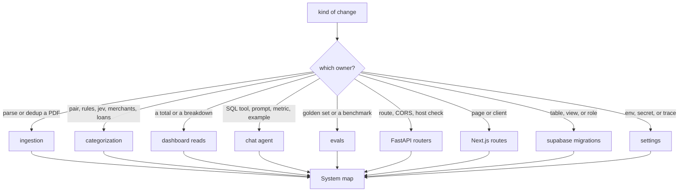

# Tally AI quickstart

Coding agents start here, then follow one link. Do not preload the rest of the wiki. Code and tests win over every document. Specs in `docs/superpowers/specs/` explain why. [Backlog](../docs/backlog.md) lists ideas that are not built. Do not present one as existing.

What the product does and how to run it is [README](../README.md). Why each part is built this way is [Architecture](../docs/architecture.md). Working rules stay in [CLAUDE.md](../CLAUDE.md). This page does not restate them and does not copy those documents.

The money contract is [Money rules](../docs/money-rules.md). Link it. Do not restate it. The v1 spec's section 9 (a jev router in front of the chat) was superseded by [slice 4, section 16](../docs/superpowers/specs/2026-10-12-slice-4-chat-design.md). The shipped chat is one ReAct agent with no router.

## Where a change lives

Python in `apps/api/finance` owns ingestion, categorization, dashboard reads, the chat agent, and evals. Next.js in `apps/web` is the browser. Supabase Postgres is the ledger. The browser never opens Postgres. Pages call the API at `NEXT_PUBLIC_API_URL` (default `http://localhost:8000`).

Pick the owner, then open the page that owns the behavior. [System map](architecture/system-map.md) is the package map if the row below is not enough.

| You are changing | Start in | Then read |
| --- | --- | --- |
| A PDF adapter, dedup, balance chain, or `import_statement` | `apps/api/finance/ingestion` | [Import to dashboard](workflows/import-to-dashboard.md) |
| Pairing, system rules, jev questions, merchants, thresholds, or `link_loans` | `apps/api/finance/categorization` | [Categorization cascade](concepts/categorization-cascade.md) |
| A review card, a label, a merchant default, a rename, or a note | `categorization/labels.py`, `review_queue.py`, and the `/review` route | [Review and labels](workflows/review-and-labels.md) |
| `spend`, `income`, a dashboard aggregate, or a subscription total | `apps/api/finance/dashboard` and `v_transactions_enriched` | [Money rules contract](concepts/money-rules.md) |
| `run_sql`, the guard, the prompt, a metric, or an example | `apps/api/finance/agent` | [Chat agent](concepts/chat-agent.md) |
| A question from the composer through the stream | `apps/web` chat routes and `finance/api/chat.py` | [Ask a question](workflows/ask-a-question.md) |
| The categorization benchmark or how to read a history line | `apps/api/finance/evals` | [Run the categorization eval](workflows/run-categorization-eval.md) |
| A table, view, grant, or `agent_reader` | `supabase/migrations` | [Data model and migrations](architecture/data-model.md) |
| An env key, CORS, trusted hosts, or what a trace receives | `finance/settings.py`, `finance/tracing.py` | [Configuration and tracing](operations/configuration.md) |
| Which command proves the change | the matching task or recipe | [Verify a change](operations/verify-a-change.md) |

A new bank is a new adapter plus a `bank` enum value, not a change to the cascade. A new total sums `v_transactions_enriched`. Do not recompute spend or income in the web app. A new chat metric or example lives in `apps/api/finance/agent/semantic/` and is checked at startup. Do not add a second agent tool, and do not grant `agent_reader` beyond the `agent` schema.

## Entrypoints

`apps/api/pyproject.toml` exposes the CLI as `finance = "finance.cli:app"`. From `apps/api`:

| Command | Role |
| --- | --- |
| `uv run task api` | FastAPI on port 8000 (`uvicorn finance.api.main:app --reload`) |
| `uv run finance import <pdf>` | Parse and insert, then categorize in the same process |
| `uv run finance seed` | Upsert taxonomy and system rules from `supabase/seed` |
| `uv run finance categorize [--all] [--rules-only]` | Pairing, rules, and jev unless `--rules-only` |
| `uv run finance labels export` or `import` | Golden set and notes as CSV, keyed by `dedup_key` |
| `uv run finance eval-categorization --note "..."` | Paid dry-run benchmark. Not CI. |
| `uv run finance chat ["question"] [--thread ID]` | Same agent as the web, in the terminal. xAI spend. |

`finance seed` is not a migration. Migrations do not load `supabase/seed/categories.yaml` or `rules.yaml`.

The API process opens the chat in its lifespan (`open_chat` on `app.state.chat`) and mounts the account, category, categorize, chat, dashboard, import, merchant, review, spending, and transaction routers. `GET /health` is the liveness check. Unsafe methods that send an `Origin` must pass `same_origin`. CORS and `TrustedHostMiddleware` wrap the app. A missing `SUPABASE_DB_URL`, or an `xai:` model without `XAI_API_KEY`, disables chat only. Dashboard routes keep working. Chat routes return 503.

The web app is `apps/web` (`npm run dev` on port 3000). Routes are `/`, `/transactions`, `/subscriptions`, `/spending/[group]`, `/income`, `/merchants/[id]`, `/chat`, `/chat/[id]`, `/review`, `/imports`, and `/settings`. The AI SDK `useChat` is only the browser transport. The agent stays in Python.

## Verify, then stop

Match the change to a command in [Verify a change](operations/verify-a-change.md). Name the command that actually ran.

From `apps/api`, `uv run task test` is unit tests with no database and no network. `uv run task lint` is ruff check and format check. `uv run task test-integration` needs local Supabase and the repo-root `.env`. It is not CI. From `apps/web`, CI runs `npm run lint` and `npm run build`. `npm run test` (vitest) is not CI. Playwright is not this suite.

A flow a person can see or operate is checked with agent-browser against the running API and web, not with a first-render screenshot. Checks that write labels, notes, merchant defaults, renames, or imports run on a scratch copy of the database. That recipe is **R2**. Chat checks run on scripted models, never on paid ones, using `apps/api/tests/scripted_chat_server.py` on a scratch copy. That recipe is **R3**. [CLAUDE.md](../CLAUDE.md) says where both recipes live. This page does not describe their steps.

`supabase db reset` wipes labels, notes, and merchant defaults. It is not a verification command. Export labels first. The restore procedure is in [CLAUDE.md](../CLAUDE.md).

## Do not treat as built or as repo layout

- Chat evals, a check that every stated amount appeared in a query of the turn, and account balances in the chat are backlog items. They are not implemented.
- Plans under `docs/superpowers/plans/` are task history, not instructions.
- `conversation_history/` and `skills/` are OpenWiki mounts, not repository directories. Do not treat them as source.
- Do not describe `data/` or other ignored paths. Do not copy personal amounts, account numbers, IBANs, or merchant names into docs or tests. Fixtures stay short synthetic text.
