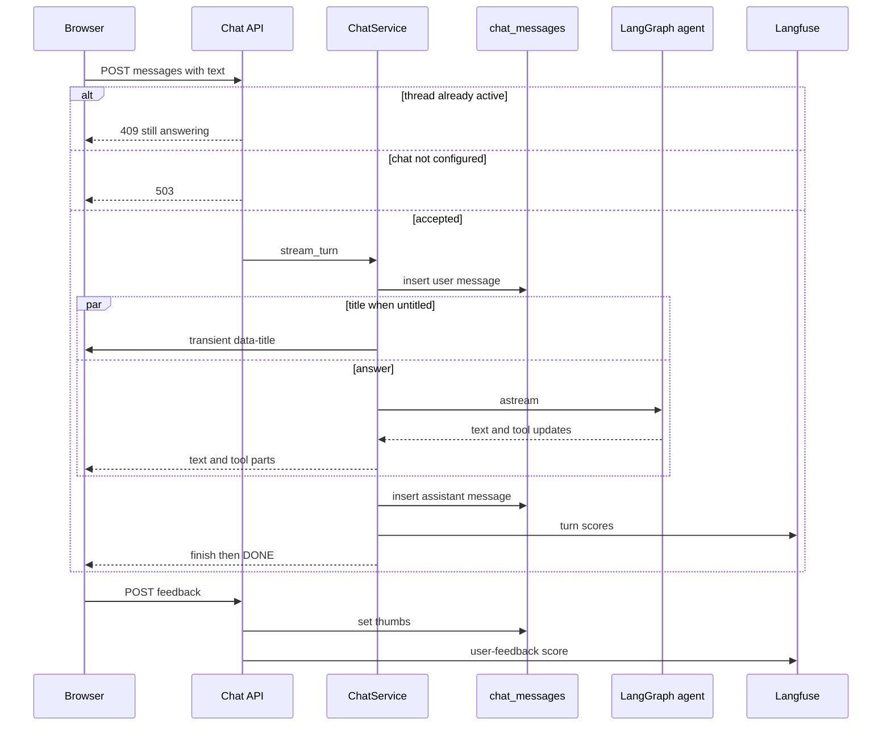

# Ask a question

A question starts in the browser and is answered by the LangGraph agent in `apps/api`. The AI SDK `useChat` is only the browser transport. It does not run the agent and it does not keep the history. The API keeps both, and the stream carries only the new question plus the answer parts.

What the agent may read, and how a metric changes safely, is [Chat agent](../concepts/chat-agent.md). Knobs and the 503 conditions are [Configuration](../operations/configuration.md). How to check this flow without a paid model is [Verify a change](../operations/verify-a-change.md).

## Who owns the turn

| Piece | Owns |
| --- | --- |
| `NewChat`, `Conversation`, `Composer` | The question box, Stop, and the live transcript |
| `ChatsProvider` | One `Chat` per opened thread, so navigation does not drop the stream |
| `chatTransport` | `POST /chat/threads/{id}/messages` with only the new text |
| `send_message` | The AI SDK UI message stream, or 409 / 503 / 404 before it starts |
| `ChatService` | One turn at a time per thread, the agent task, the save, the scores |
| `chat_messages` | The history a reload shows |
| LangGraph checkpoint | The agent's own memory, keyed by the same thread id |

`open_chat` builds the `ChatService` for the API lifespan and stores it on `app.state.chat`. The same context manager is what `finance chat` uses, so a terminal session and the web share threads. If the database URL is missing, or the model is `xai:` and `XAI_API_KEY` is missing, it yields `None`. Dashboards keep working. Every `/chat` route then answers 503 with the detail that `SUPABASE_DB_URL` and `XAI_API_KEY` must be set. The `/chat` layout catches that 503 and shows how to add the key and restart the API. A later request from the composer says the same thing through `chatErrorText`.

## From the box to the stream

`/chat` does not create a thread until the first question. `NewChat` calls `POST /chat/threads`, puts that thread first in the sidebar, starts `sendMessage` on a `Chat` with an empty history, and navigates to `/chat/<id>`. `Conversation` asks `chatFor` for the same instance, so the answer that started on the new-chat page keeps streaming after the route change. Opening another chat does not cancel it either. The instance lives in the layout's client state until the thread is deleted.

`/chat/<id>` loads `GET /chat/threads/{id}/messages` on the server. A non-UUID or a 404 is the Next.js not-found page. `toUIMessages` rebuilds what `useChat` expects: each saved query becomes a finished `tool-run_sql` part, placed before the text, because that is the order a live answer streams in. An answer with empty content, a stop before any text, has no text part.

The composer trims the question, caps it at 4000 characters, and sends on Enter. Shift+Enter starts a line. While `useChat` status is `submitted` or `streaming`, the send button becomes Stop. `chatTransport` posts `{ text }` to that thread's messages route. The body is only the latest user message. The API already has the earlier turns, both in `chat_messages` and in the checkpoint. A blank or whitespace-only body is 422 and is not stored.

One accepted question, from the messages route to the saved answer and a later thumbs score. A busy thread or an unconfigured chat never starts the turn.

## What the stream contains

`stream_turn` refuses a thread already in `ChatService.active` with `ThreadBusy`. The route turns that into 409 and the sentence "This chat is still answering. Wait for it or stop it first." The same set blocks delete. A send that arrives while a delete is waiting on the database gets `ThreadBusy` too, so it cannot start a turn whose checkpoint the delete would then drop.

An accepted turn is an asyncio task. The HTTP generator only relays a queue, so the client leaving does not cancel the save by itself. The first part is `start` with the assistant message id. The last parts are `finish` and the SSE `[DONE]`. The response is `text/event-stream` with `x-vercel-ai-ui-message-stream: v1`, `cache-control: no-cache`, and `x-accel-buffering: no`.

`ui_parts` reads `astream(stream_mode=["messages", "updates"], version="v2")`:

- Model text, and the two notice nodes, become `text-start`, `text-delta`, and `text-end`. The model-call limit notice is rewritten to the fixed narrower-question sentence. The checkpoint keeps LangChain's own wording.
- A `run_sql` call becomes `tool-input-available`. Its artifact becomes `tool-output-available` and is appended to the turn's query list. A tool message without an artifact, including a call the per-turn SQL limit refused, is streamed as `{error}` only.
- An update that rewrites history carries `RemoveMessage` and is skipped, so summarization and the dangling-call repair are not streamed as a second copy of old messages.

The disclosure stays closed. Consecutive `tool-run_sql` parts form one block. Opening it stops stick-to-bottom so the rows the user asked to read are not scrolled away. A running query shows its own spinner. "Thinking…" appears only when nothing else on screen is moving: no assistant message yet, or the last block is queries that have all returned. The SQL and the rows are visible only inside that disclosure. The answer markdown is rendered without images, so a URL in an answer cannot make the browser request another host.

On the first turn, if `title_source` is still null, a title task runs beside the answer and does not block the first model call. A successful store emits a transient `data-title` part. `useChat` hands that to `onData` only. It never becomes a message part. The sidebar patches the title from it. A user rename sets `title_source` to `user`, and a later generated title is stored only while that column is still null. Title failure falls back to the question text. It is cosmetic and does not fail the answer.

## Persistence and the two memories

The user message is inserted before the agent runs. The assistant row is inserted in the turn's `finally`, with the same id the stream announced, the joined text, the query artifacts, the status, and the Langfuse trace id. Inserting a message also sets the thread's `updated_at`, which is why the sidebar lists newest activity first. A rename does not. Reload reads `chat_messages`, not the checkpoint. The checkpoint is the agent's memory. Summarization rewrites it. The visible history does not shrink.

`delete_thread` removes the rows (`chat_messages` cascades) and calls `checkpointer.adelete_thread`. The header disables Delete while an answer is in flight. A 409 still surfaces the busy sentence. A 404 is treated as already deleted.

## When it does not finish

| What happened | Stream | Saved status | Next turn |
| --- | --- | --- | --- |
| Client stops or disconnects | Generator closes. No `finish` if the client already left. | `stopped`, with whatever text and queries had arrived | Allowed after the save. The dangling tool call is closed before the next model call. |
| Model or other exception | `error` part, then `finish` | `error` | Allowed. The thread is released in `finally`. |
| Database unreachable before the agent, or a query artifact with `infra_error` | Fixed unreachable-database sentence | `error` | Allowed. Another model call is not spent on the outage. |
| SQL call limit | The refused call is `{error}` only. The model may still answer. | `ok`, unless something else failed. Langfuse level `WARNING` if the answer otherwise succeeded. | Allowed |
| Nobody reads the stream | The task still runs to the save | Whatever the turn produced | The thread is released even if the client never reads |

Stop is `useChat`'s `stop()`, which aborts the request. The relay cancels the turn task, then `asyncio.shield`s the wait so that server-side cancellation of the generator does not cancel the turn a second time inside the save. The partial answer is stored as `stopped`. The browser's `onFinish` sets the same status locally, drops any `tool-run_sql` part that never received output, and marks the answer as able to take feedback only when the status is `ok`. A stopped answer shows "You stopped this answer." An error answer shows "This answer did not finish." Thumbs are rendered only for `ok`.

A question the API refused, or never received, is put back in the composer. `unanswered` returns the text only when the last message is still the user message. Once an assistant message exists, the question was saved and is not restored.

The two fixed sentences are `Something went wrong while answering. Try again.` and `I can't reach your database right now. Try again in a moment.` The second is used when the failure is a connection error, including a pool timeout while saving the question, and when `stop_on_infra_error` ends the turn after a query artifact with `infra_error`. A query that fails for a bad column is not that case. It comes back as a `QueryResult` with a hint, the model can answer, and the disclosure shows the failure.

## Feedback

Thumbs are a separate request after the answer is saved: `POST /chat/messages/{id}/feedback` with `up` or `down` and an optional comment of at most 1000 characters. Up is sent immediately. Down asks for the comment first, so one request carries both. The store writes `feedback` on an assistant row and returns `langfuse_trace_id`. A missing answer is 404. When a trace id exists, the route writes one Langfuse score named `user-feedback`, value `1.0` for up and `0.0` for down, `data_type` `BOOLEAN`, and `score_id` `{message_id}-feedback`. A second click replaces that score. The local transcript updates only after the POST succeeds.

The turn itself, when it has a trace id, writes five scores after the save: `sql_calls`, `sql_errors`, `hit_sql_limit`, `stopped`, and `infra_error`. The observation is `chat-turn`, with the thread id as `session_id` and `chat.user_id` (default `local`) as `user_id`. Without Langfuse keys the client records nothing. Chat still answers. The scripted chat server turns tracing off before it imports the app.

## Check this flow

Chat checks run on scripted models, never paid ones. The recipe is **R3**. [CLAUDE.md](../../CLAUDE.md) says where it is. This page does not describe its steps. The process those checks start is `apps/api/tests/scripted_chat_server.py`. How to run it, and the scratch-database guard, is [Verify a change](../operations/verify-a-change.md).

`uv run task test` from `apps/api` covers the route unit checks that do not need a database: 503 when `app.state.chat` is `None`, and one `user-feedback` score per answer. The web helper checks are `apps/web/src/lib/chat.test.ts` (`npm run test` from `apps/web`). They lock the body that sends only the new question, the history rebuild, the thinking rule, and the 409 / 503 wording.

The integration checks that need the database are `tests/test_chat_api.py` and `tests/test_chat_service.py`, under `uv run task test-integration`:

| Test | What it locks |
| --- | --- |
| `test_a_message_streams_in_the_ai_sdk_protocol_and_lands_in_the_history` | UI stream header, `start` / `finish` / `[DONE]`, transient title, both rows saved |
| `test_a_second_message_while_answering_is_409` and `test_a_chat_cannot_be_deleted_while_it_answers` | Busy thread |
| `test_a_request_closed_mid_answer_saves_the_stopped_answer_over_real_http` | Stop over real HTTP saves `stopped` |
| `test_a_stopped_answer_is_saved_as_stopped_and_the_thread_keeps_working` | The next question still runs |
| `test_a_turn_nobody_reads_still_finishes_saves_and_frees_the_thread` | An unread stream still saves and releases |
| `test_a_database_outage_ends_the_turn_saves_it_as_error_and_the_thread_keeps_working` | Infra error, then a later successful turn |
| `test_feedback_is_stored_on_an_answer_and_unknown_answers_are_404` | Thumbs on the saved row |
