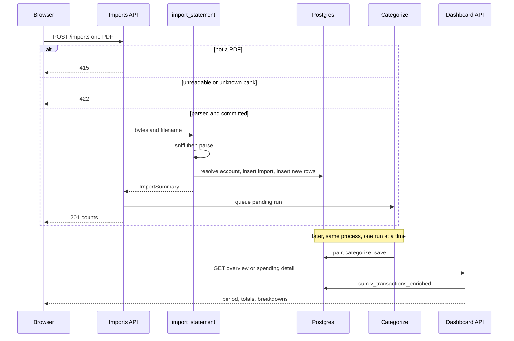

# Import to dashboard

A statement becomes a number only after four owners finish their part. Ingestion parses a BBVA or CaixaBank PDF and inserts new movements. Categorization classifies those rows later, in the background. The dashboard package only reads `v_transactions_enriched`. The browser never opens Postgres.

Who owns each package is [System map](../architecture/system-map.md). What the numbers mean is [Money rules](../concepts/money-rules.md). How a pending row gets a category is [Categorization cascade](../concepts/categorization-cascade.md). How to check a change is [Verify a change](../operations/verify-a-change.md).

## Who owns each step

| Piece | Owns |
| --- | --- |
| `/imports` | Upload zone, coverage board, and the full import history. A `MORE_ITEMS` destination, not a main nav pill |
| `UploadForm` | One `POST /imports` per selected PDF, then a refresh. It does not wait for categories |
| `POST /imports` | Content type, the insert, and the background task. It returns 201 after the insert |
| `GET /imports` | Every import, uncapped, ordered for the board and the history |
| `import_statement` | Adapter, account, import record, deduped insert |
| `run_categorization_logged` | One cascade at a time. A failure here is logged, not returned |
| `GET /dashboard/overview`, `GET /spending/detail` | Period, totals, breakdowns, and the latest rows |
| `/`, `/spending/*`, `/income` | Display of those responses. They do not recompute spend |

`finance import` uses the same `import_statement`. It categorizes once, after every file, in the same process, and prints a categorization exception instead of scheduling it. A bad file there is a line on stderr and exit code 1; the other files in the same command still import.

## From the PDF to the ledger

Imports is not a main nav pill. `MORE_ITEMS` in `nav-links.tsx` holds Imports and Settings. From `lg` up, `MoreMenu` opens that list from a round button labelled "Imports and settings". Below `lg`, the sheet lists the main pages, a separator, then the same two destinations. The Imports hint is "Upload statements, see coverage". The link does not keep period or account filters.

`/imports` is a `force-dynamic` server page. It loads `GET /imports` and `GET /accounts` together, then renders three pieces in order: the upload card, `CoverageBoard` only when there is at least one import, and `ImportHistory`. The upload copy still says each import starts a categorization run in the background. `today` is the server's own calendar day (`en-CA`, so `YYYY-MM-DD`) and is passed into the board. The client does not recompute it.

`UploadForm` is a drop zone, not a separate Import button. The native file input covers the zone, accepts `application/pdf`, and allows one or many files. Choosing or dropping starts the import at once. Each file is posted alone as multipart field `file`. A success line is the filename plus `rows_new` and `rows_duplicate`. A string `detail` is shown as the error; otherwise the status and body. After the batch, the input is cleared so the same file can be picked again, and `router.refresh()` reloads the page. The form does not wait for categories. While busy the input is disabled, and a drop is cancelled so the browser does not open the PDF in this tab.

`create_import` rejects any other content type with 415 before reading the body. A PDF is passed to `import_statement`. `UnsupportedStatement` and `ValueError` become 422 and schedule nothing. Only a returned summary schedules `run_categorization_logged` with no arguments, so the run is pending rows only. The response is 201 with that summary: import id, account id, bank, last four of the IBAN, filename, and the three row counts. The full IBAN is not in the response.

One upload: reject, or commit then queue. The overview reads whatever the ledger holds when the page loads, including rows still waiting for a category.

### The list the page reads

`GET /imports` returns every import. There is no `limit`. `LIST_IMPORTS_SQL` in `apps/api/finance/api/imports.py` has no `limit`, which `tests/test_api.py` asserts. The order is `period_end desc nulls last`, then account name, then `imported_at desc`. `ImportRecord` still carries `filename`. The page does not render it.

`ImportHistory` keeps that order. `groupByEndMonth` opens one section per `YYYY-MM` of `period_end`. A statement that spans two months lands in the month it ends. Rows with a null `period_end` form a last group labelled "No period". Columns are Period, Account, Imported, Rows, New, and Duplicate. Imported is hidden below `sm`, Rows below `md`. Period uses `dayRange`, or `NoData` when either end is null. An empty list says "No statements imported yet."

### Coverage board

The board answers which months have a statement for each account. A filled month means a statement covers that account-month, not that a transaction was booked that day. States come from `apps/web/src/lib/coverage.ts`. Dates are `YYYY-MM-DD` strings compared as text. A month runs from its first day to its last, in UTC. An import with a null start or end is ignored and, alone, does not make a later month a gap.

For one account and one month, in order:

1. `covered` when a period starts on or before the first day and ends on or after the last day.
2. `partial` when a period overlaps the month and none covers every day. Two partials that together fill the month stay `partial`. Touching or overlapping spans are merged for the popover.
3. `gap` when the month has ended (`month.end < today`), nothing overlaps it, and this account has a statement that ended before the month. The current month is never missing. A month is expected only once its last day is before today.
4. `outside` otherwise: the month has not ended, or the account has no earlier statement. Drawn blank, legend "Not expected".

`yearBounds` opens the board on the year of the latest dated `period_end`. The arrows run from the earliest dated `period_start` year to the later of that year and today's year, and stop at the ends. Accounts are ordered by name. January is index 0. The missing line lists the visible year's gaps, newest month first: the month name and the account name, or a count when several accounts miss it. No gaps reads "Nothing missing in {year}."

A month whose first day is after today is muted text, not a button. Every other month opens a popover on hover or click. The popover lists whole-month, partial, and missing accounts. It does not filter anything and it has no link. While it is open, that column gets a faint tint. Squares are decorative; the month button and the popover carry the words.

How a month with no imported row is drawn on the overview is the Comparisons section of [Money rules](../../docs/money-rules.md). Do not restate it, and do not recompute those columns in a page.

### Detect and parse

`detect_adapter` extracts page text with `x_tolerance=1` and asks each adapter in `ADAPTERS` to sniff the first page. The list is BBVA, then CaixaBank. An empty page list, or a file pdfplumber cannot read, raises `UnsupportedStatement`. A readable PDF that neither adapter claims raises the same error and names the supported banks.

| Adapter | Sniff | What a row is | Period | Balance order |
| --- | --- | --- | --- | --- |
| `BbvaPdfAdapter` | Compacted first page contains `EXTRACTODE` and `F.Oper.` | Dated operation line plus the next detail line, stopped at the footer | Calendar month of `EXTRACTO DE <month> <year>` | Ascending, oldest first |
| `CaixaBankPdfAdapter` | Compacted first page contains `ConceptoFechaImporteSaldo` and `Periodo` | One concept-date-amount-balance line | The printed `Periodo` range | Descending, newest first |

Both parse Spanish amounts and dates, store a space-stripped IBAN, and set `merchant` with `normalize_merchant` (leading reference numbers dropped, spaces collapsed, upper case). BBVA joins the concept and the detail with ` | `. CaixaBank has no separate concept. A January value date on a December BBVA statement rolls into the next year, and the reverse rolls back. A header that does not match raises `ValueError` before any insert.

After the rows are built, `check_balance_chain` requires each printed balance to equal the previous balance plus this amount. BBVA walks the file as printed. CaixaBank reverses it first. Fewer than two rows, or any row with no printed balance, skips the check. A break raises `ValueError` that names the bank, the printed index, and both balances, and says nothing was imported. That is the guard against a regex silently dropping a line.

### Account, import record, dedup

`import_statement` does the write in one transaction.

1. Resolve the account by the parsed IBAN. An existing row is reused. A new row is inserted with bank, IBAN, and a display name of the bank plus the last four. The IBAN stays in `accounts` and is not returned by the list routes. `GET /accounts` returns `iban_last4` only.
2. Insert `imports`: filename, SHA-256 of the PDF bytes, period, and `rows_total`. The hash is stored. It is not the duplicate check. The same file uploaded again still parses and still tries every row.
3. Build insert tuples in `transaction_rows`, then insert each with `on conflict (dedup_key) do nothing`. `rows_new` is the sum of `rowcount`. `rows_duplicate` is the rest. Both are written back onto the import record.

A new row starts as `income` when `amount > 0`, otherwise `expense`. `category_source` stays the column default `none`. Categorization may later change `tx_type`. Until it does, the dashboard still counts the sign-based type through the money view.

`structure` splits what the cascade reads. For BBVA, `bank_concept` is the text before ` | `. CaixaBank has none. A 12-to-19 digit token is removed from concept and merchant text and kept as `card_last4`. The raw description keeps the digits. The explorer masks them on the way out with `mask_card_numbers`.

The dedup key is a SHA-256 hex digest. Its input is the IBAN, the booking date, the amount to two decimals, the raw description with collapsed spaces and upper case, the printed balance (empty when missing), and the occurrence index of that fingerprint in this file. Two identical movements in one statement get indexes 0 and 1, so both insert. The same movement in a later overlapping statement gets index 0 again and conflicts. A different IBAN is a different key. Spacing and case in the description do not change the key.

## Background categorization

The 201 is already committed when the task runs. FastAPI runs the sync function in its threadpool. `run_categorization_logged` takes a process-wide lock, calls `run_categorization` for pending rows, and logs the summary. Any exception is logged and swallowed. The upload does not roll back, and a later `POST /categorize/run` can queue the same function again. `?all=true` on that route re-runs non-user rows. The import route never passes that flag.

Pending means `category_source = 'none'`. The cascade pairs own-account transfers, applies system rules, and calls jev only when `TYPESAFE_API_KEY` is set. A missing key still pairs and applies rules. Rows jev cannot answer stay pending. User labels are not overwritten. Two uploads cannot categorize at once in this process. A second API process would not share the lock.

Until that run finishes, new rows are visible to the dashboard as uncategorized income or expense. An overview refresh after the upload can therefore change again when the run writes categories, transfer types, and merchants. The coverage board does not wait for that run: it reads statement periods, not categories.

## What the web reads

Dashboard SQL does not read `transactions` for money. It sums `v_transactions_enriched`, whose `spend` and `income` follow `tx_type`. Transfers are zero in both. How a month with no imported row is drawn is the Comparisons section of [Money rules](../../docs/money-rules.md). Do not restate it, and do not recompute those columns in a page.

Every dashboard read takes the period query: `period` (default `month`), optional `month`, `start` and `end` for `custom`, and repeated `account_id`. `resolve_request` anchors a relative period on the latest `booked_at` of the selected accounts, or today when there is no row. How a previous period is cut, and when no change is shown, is the Comparisons section of [Money rules](../../docs/money-rules.md). Do not restate it. The cumulative chart does not use that cut.

`GET /dashboard/overview` is the home page. KPIs use `totals` with no type filter. Group, category, and merchant charts use `breakdown` on expenses. The current cumulative line is omitted when there is no latest day. `group_slots` ranks groups by all-time spend so a period change does not recolor them. The subscription card is `summary(active_subscriptions)`, which reads `v_subscriptions` and ignores the account filter. The page says so.

`GET /spending/detail` is one scope. The route sets `tx_type`, optional `level1`, `category`, and `merchant_id`. Child rows are categories under a group, merchants under a category (top 10 plus `_other`), and none under a merchant. It also returns five latest transactions, a 12-month series, and the same cumulative pair. The overview's category and merchant charts fold at five. A group chart does not fold.

| Page | Call | Empty state |
| --- | --- | --- |
| `/` | `GET /dashboard/overview` and `GET /categories` | `latest_day` null: "No statements yet", or "No transactions in these accounts" when an account filter is on. Both link to `/imports` |
| `/spending/[group]` | `GET /spending/detail?type=expense&level1=` | Unknown slug is not-found |
| `/spending/[group]/[category]` | same, plus `category` | Unknown category for that group is not-found |
| `/income` and `/income/[category]` | `GET /spending/detail?type=income` | Same detail template. More income is good |
| `/subscriptions` | `GET /dashboard/subscriptions` | Not period-scoped |
| `/transactions` | `GET /transactions` | The explorer. Card numbers in `description_raw` are masked |
| `/imports` | `GET /imports` and `GET /accounts` | History: "No statements imported yet". The board is omitted until the first import |

Pages are `force-dynamic` and fetch with `cache: "no-store"`. Filters travel as search params and are appended by `filterParams` / `withFilters`. The shell's account list and default month come from `filterContext`, which times out at 2 seconds and returns an empty context if the API is down. Imports does not keep those filters.

A page must not invent a total from `amount`. Income, expenses, savings, and savings rate are already on the overview payload. A spending page uses `total` from the detail payload. Formatting lives in `apps/web/src/lib`.

## Failures that must stay separate

- A non-PDF is 415. An empty, corrupt, or unrecognized PDF is 422. Neither writes an import row or a transaction, and neither queues categorization.
- A balance-chain break or a missing header is the same 422. The transaction rolls back. The error says nothing was imported.
- A second upload of the same movements returns 201 with `rows_new = 0`. It still inserts an `imports` row and still queues a run. The run finds no new pending rows from that file. The history shows the extra import. The board does not treat a second covering statement as a second state.
- Categorization failing after a good insert still returns 201. The rows stay pending until a later run. The coverage board still paints the statement's period.
- A foreign `Origin` on `POST /imports` is 403 before the insert. Requests with no `Origin` (CLI, curl, tests) pass. `TrustedHostMiddleware` refuses a request whose `Host` is not in `trusted_hosts`.
- Dashboard reads do not write. A missing custom range is 422 from `resolve_request`. An unknown spending slug is a Next.js not-found, not an empty chart of zeros.

## Adding a bank

A new bank is a new `BankAdapter` in `ADAPTERS`, a `bank` enum value, and a parser that returns `ParsedStatement`. Sniff the first page only. Call `check_balance_chain` with the order the statement prints. Do not put categorization in the adapter. `import_statement` already resolves the account, builds the dedup key, and inserts. Update the upload copy only if the product should name the new bank. The web does not branch on bank for the dashboard or the coverage board: a filled month is a period on that account, whatever the bank.

Do not use the file hash as the duplicate rule. Overlapping statements are deduped per movement. Do not include the occurrence index from a previous file. It is computed only inside the file being imported.

Do not put a `limit` back on `GET /imports`. The board and the history both read that list. Pagination of the history is out of scope. Do not filter the overview, Transactions, or the history from a month on the board.

## Verify

From `apps/api`:

- Unit, no database: `tests/test_adapters.py`, `tests/test_bbva_pdf.py`, `tests/test_caixabank_pdf.py`, `tests/test_balance_chain.py`, `tests/test_dedup.py`, `tests/test_importer.py` (the pure `transaction_rows` cases), and `tests/test_api.py` for 415, 422, 403, a 201 that still reports counts when categorization raises, and `LIST_IMPORTS_SQL` containing no `limit`.
- Integration, local Supabase: `tests/test_imports_api.py` seeds an older, a newer, and a null period and expects `GET /imports` with null periods last. `tests/test_importer.py` uses real statements in `data/raw` and skips if none are there. `tests/test_views.py` and `tests/test_dashboard_api.py` lock the read side. `uv run task test-integration` is not CI.

From `apps/web`:

- `src/lib/coverage.test.ts` locks the four states, the current month never being a gap, merged partials, `yearBounds`, and `missingSummary`.
- `src/lib/import-history.test.ts` keeps API order inside a month, puts a spanning statement in its end month, and puts null periods last.

A UI import writes the ledger. Check it with agent-browser on scratch-database recipe R2, named in [CLAUDE.md](../../CLAUDE.md). Do not invent that recipe's steps. Do not describe `data/` or paste statement contents into a test or a page.
