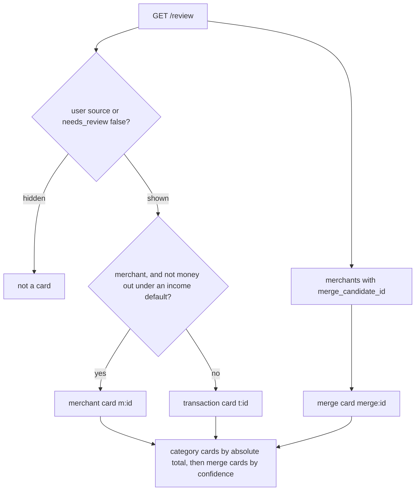
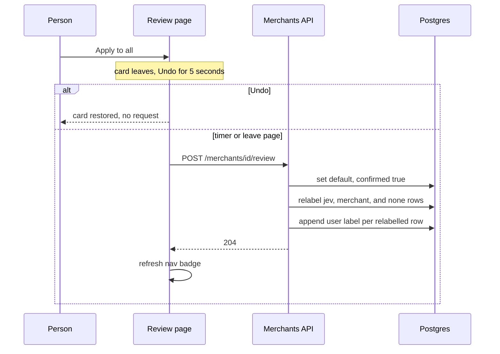

# Review and labels

A person corrects a merchant once. That answer becomes the merchant default for later imports, a `user` label on every row the confirm is allowed to touch, and a row in the golden set. The inbox at `/review` is one card per merchant, plus a separate card when two merchants might be the same. A single transaction can still be labelled on its own, from an expanded card or from the transaction panel. Neither path is overwritten by a later categorization run.

How a row reaches the inbox is [Categorization cascade](../concepts/categorization-cascade.md). How to score the golden set is [Run categorization eval](run-categorization-eval.md). How to choose a check is [Verify a change](../operations/verify-a-change.md).

## What each piece owns

| Piece | Owns |
| --- | --- |
| `GET /review` | Category cards and merge cards. It does not write. |
| `GET /review/count` | Nav badge (`pending`), plus category, merge, and uncategorized counts. |
| `/review` | One correction per card, a 5-second undo, skip for this tab only. |
| `POST /transactions/{id}/label` | One transaction: category, subscription, and an optional merchant. |
| `POST /merchants/{id}/review` | The merchant default, and a relabel of the rows that default may change. |
| `DELETE /merchants/{id}/default` | Clears the default. Existing row labels stay. |
| `PATCH /merchants/{id}` | Rename, or merge into another merchant. No category and no user label. |
| `POST /merchants/{id}/dismiss-merge` | Drops a duplicate suggestion and marks the merchant confirmed. |
| `PATCH /transactions/{id}` | The note. Not a label and not label history. |
| `finance labels export` / `import` | The golden set and notes, keyed by `dedup_key`. Not merchant defaults. |

Writes that change labels, notes, merchant defaults, renames, or imports are verified with scratch-database recipe R2. Name R2 and follow [CLAUDE.md](../../CLAUDE.md). Do not run those checks against the real database.

## The inbox

`/review` loads `GET /review`, `GET /categories`, `GET /merchants?limit=5000`, and `GET /review/count` on every request (`dynamic = "force-dynamic"`). The API builds cards in `build_review_items`. The query that feeds category cards is:

```sql
where t.category_source <> 'user' and t.needs_review
```

User-labelled rows never appear, even if something else set `needs_review`. Rows still at `category_source = 'none'` are not cards. They are the `uncategorized` count: no categorization run has handled them, or jev failed and left them pending. The page tells the reader to wait for the background run and reload before starting another. An empty inbox with that count at zero is "All caught up".

`needs_review` is set by the cascade, not by this page. A jev category below `category_threshold` (default 0.95) is reviewed. A new merchant name dropped by the brand gate is reviewed. A merchant default, a rule, and a pair clear the flag. Equal to 0.95 is accepted and does not enter the inbox. See [Categorization cascade](../concepts/categorization-cascade.md).

### One card per merchant

Rows that share a merchant are one `kind: "merchant"` card, key `m:<merchant id>`, including refunds. A row with no merchant is its own `kind: "transaction"` card, key `t:<transaction id>`. Money going out stands alone when the merchant's default is an income category: confirming the group would otherwise overwrite that default with a category the outgoing row cannot take.

The suggestion is the category with the highest average probability across rows that have a probability map, then the top three. Level 1 follows that slug. If no row has probabilities, the first row's slug and confidence are used. Subscription is suggested when any grouped row is already flagged. Card numbers in `description_raw` are masked to the last four digits in the API response. The full number stays in the database.

Category cards are ordered by largest absolute total, then key. The page can re-sort those cards by latest booking date. That sort is display only. The API order stays amount.

### Merge cards are a second question

Any merchant with `merge_candidate_id` set is a `kind: "merge"` card, key `merge:<source id>`, even when it has no review rows. The cascade writes that pointer when a new name shares a word with a known merchant and the same-merchant confidence is at or above `merge_suggestion_floor` (0.3) and below `merge_threshold` (0.5). Both comparisons are inclusive at the lower edge. 0.5 attaches the row to the known merchant and writes no card. 0.3 creates a separate merchant and stores the suggestion. 0.29 creates a separate merchant and stores nothing. Do not put 0.8 back, and do not treat 0.5 as the suggestion floor. Merge cards follow the category cards, most confident first. The settings comment points at [eval history](../../docs/evals/HISTORY.md) (2026-10-17) for why 0.5 is the merge default. Lines in that file marked not kept are not the shipped default. Do not quote merchant names from its notes. How the cascade asks the question is [Categorization cascade](../concepts/categorization-cascade.md). The setting itself is [Configuration](../operations/configuration.md).

Confirming a category does not dismiss the duplicate. The page copy treats them as separate questions, and `confirm_merchant` leaves `merge_candidate_id` in place unless the confirm itself renames or merges. `GET /review/count` sets `pending` to the card count, `merges` to merge cards, and `categories` to the rest. The nav badge is `pending`, loaded by the root layout from `reviewCount()` with a 2-second timeout. A slow or down API hides the badge (`null`) rather than blocking the page. After a saved change the review list calls `router.refresh()` so the badge reloads. The root layout does not re-render on client navigation by itself.



What becomes a card: non-user rows that still need review, grouped by merchant, then a separate merge card for every pending duplicate.

### What the person does on a card

Category cards start on jev's suggestion only when that slug fits the direction. Money out never starts on an income category. The confidence percentage is shown only while the picker still holds that suggestion. Money in has no subscription switch. Only money out can be a subscription.

| Action | Request | What leaves the page immediately |
| --- | --- | --- |
| Confirm or Apply to all on a merchant card | `POST /merchants/{id}/review` | That card. If the picker merges into another merchant, that survivor's category cards and the source's other cards leave too. |
| Confirm on a lone transaction | `POST /transactions/{id}/label` | That card. |
| Only this one, on an expanded line | `POST /transactions/{id}/label` | That line. The merchant card stays, with a recomputed count and total, until its last line is labelled. |
| Yes on a duplicate | `PATCH /merchants/{source}` with `merge_into_id` | The source's cards and any duplicate card that pointed at the source. The survivor's own duplicate card stays. |
| No on a duplicate | `POST /merchants/{id}/dismiss-merge` | That merge card only. |
| Skip | Nothing | The card moves to the end of this tab. |

Skip is `sessionStorage` key `review-skip:v1`. A reload in the same tab keeps the order. A new tab starts unskipped. A bad stored value means nothing is skipped. Closing the "How to review" disclosure is `localStorage` key `review-help:v1` and is remembered on the device.

The list does not POST immediately. It removes the card, shows Undo for 5 seconds, and sends on timeout. A second change on the same card sends the earlier one first, so Undo cannot restore a stale card. Leaving the page, or `pagehide`, flushes waiting requests with `keepalive`. Undo before the timer sends nothing. A failed send restores the card and toasts "Could not save that change." Filters are All, Categories, and Duplicates. They hide cards. They do not change what the server will accept.

## One correction, two writes

`label_transaction` and `confirm_merchant` both run in one database transaction. Both append a `transaction_labels` row with `source = 'user'`. The history table is append-only. The latest row for a transaction, by `labeled_at`, is the one export and eval read. Older rows stay.

`tx_type` always follows the category, not the sign of the amount. A positive amount labelled with an expense category is a refund: `tx_type` stays `expense`, and the subscription flag is forced off. A subscription mark is stored only when the category is an expense and the amount is negative. An income category on money going out raises `DirectionMismatch`. The label route returns 422. The merchant confirm does not raise: it skips those outgoing rows and still sets the income default for the rest.

### One transaction

`POST /transactions/{id}/label` checks the slug with `require_category` (unknown slug is 422), then calls `label_transaction`.

The row is updated to `category_source = 'user'`, confidence cleared, `needs_review = false`. A body `merchant_id` must already exist (404 if it was merged away while the page was open). A `new_merchant_name` is created or reused by `match_key` and sets `merchant_source = 'user'`. Omitting both leaves the current merchant. The new merchant does not receive a default. Other rows of the old merchant are untouched.

If the row is paired and the new slug is not `own_accounts`, both sides lose `transfer_pair_id`. The other side is sent back to review unless its `category_source` is already `user`. A user-labelled other side stays out of the inbox.

A missing transaction or category is 404. A name with no letter or digit is 422, because an empty `match_key` would collide with another merchant. `match_key` is uppercase letters and digits only, so `MC DONALD'S` and `MCDONALDS` are one merchant. The stored name is the first name that created the row, stripped. A later spelling does not rename it.

The transaction panel uses this same route, then optionally `PATCH /transactions/{id}` for the note, then optionally `POST /merchants/{id}/review` if the person applies the category as the merchant default. The label is sent first. A 422 on the label saves nothing. A later failure toasts that the transaction was saved and the note or the default was not.

### The whole merchant

`POST /merchants/{id}/review` is the "correct once" path. `is_subscription` is required. Omitting it is 422. `null` means "no answer": the merchant keeps its subscription flag, and each relabelled row keeps its own mark. That is what money-in confirms send, because those cards have no subscription switch. `false` clears the flag. `true` sets it, but the row update still refuses the mark on anything that is not an outgoing expense.

The confirm:

1. Optionally renames or merges first. The survivor is what gets the default.
2. Sets `merchants.category_slug`, coalesces `is_subscription`, and sets `confirmed = true`. A pending duplicate pointer is left as it was.
3. Relabels rows of that merchant whose `category_source` is `jev`, `merchant`, or `none`, except money-out rows when the new category is income. Those rows become `category_source = 'merchant'`, `needs_review = false`, and each gets a `user` history row. The user decided for them, so they join the golden set even though the live source is `merchant`.
4. Does not touch `user` or `rule` rows. The merchant page states that count as `rows_a_default_would_change`.

A confirm that also merges writes the confirmed category onto the survivor, over the survivor's previous default, and the moved rows take that category. A rename or merge that is not part of a confirm does neither: `PATCH /merchants/{id}` moves rows and label history, copies a default only when the survivor has none, copies cadence the same way, deletes the source, and inserts no user label.

`DELETE /merchants/{id}/default` nulls `category_slug` and `is_subscription`. It does not unconfirm the merchant and does not change existing rows. Later imports of that merchant go through jev again. The cascade applies a remaining default in both directions, except an income default on money out.



A merchant confirm is one request after the undo window. It writes the default and a user label for every row that default is allowed to change.

### Dismiss, rename, cadence

`dismiss_merge` sets `confirmed = true` and clears `merge_candidate_id` and `merge_confidence`. A later categorization run writes a new merge pointer only when `not confirmed`, so a dismissed merchant is not suggested again by `save`.

`rename_merchant` updates `name` and `match_key` when the key is free. If another merchant already owns that key, or the body sends `merge_into_id`, it merges. The route requires exactly one of `name` or `merge_into_id` (422 otherwise). The response is the surviving id. The merchant page navigates there and keeps the current period query.

`PATCH /merchants/{id}/cadence` stores `monthly`, `quarterly`, `yearly`, or null. It is not a label and not part of the golden set. Null falls back to the detected cadence in `v_subscriptions`. A merge copies cadence only when the survivor has none.

## What a later run will not overwrite

`load_pending` selects `category_source = 'none'`, or every non-user source when the run is `--all`. User rows are not loaded. `save` also refuses the update when `category_source = 'user'`, so a label applied while jev was answering stands and gets no new history row from that run.

A merchant default applied by the cascade writes `category_source = 'merchant'`, not `user`. Those rows can be re-categorized by `--all` and can be moved again by a later confirm. The user history rows from the confirm are what eval trusts, not the live source.

A note is `transactions.note`, trimmed, at most 500 characters. Empty or whitespace clears it. It has no label history. The field is required on `PATCH`: `{}` is 422 and does not clear the note. `null` does.

## Export and import are the golden set

`transaction_labels` does not survive a database reset. `finance labels export` writes a CSV keyed by `dedup_key` so the golden set can be loaded again after statements are re-imported. The columns are `dedup_key`, `category_slug`, `is_subscription`, `merchant`, `note`.

Export takes the latest `source = 'user'` label per transaction, left-joined to the merchant name, and also includes transactions that have a note and no user label. It refuses to overwrite an existing file unless `--force` is passed. The default path is `data/labels/labels-YYYYMMDD.csv`. That directory is not documentation. Do not describe its contents.

Import looks up each row by `dedup_key`. A missing key increments `missing` and is skipped. A non-empty category calls `label_transaction` (subscription is true only for `1` or `true`, case-insensitive) and may create the merchant by name. A non-empty note calls `set_note`. Label and note for one CSV row share a transaction, so a bad note rolls back that row's label too. A bad row is reported as `line N: ...` and the other rows still import. A short row, or a CSV from before the note column existed, reads missing fields as empty. `utf-8-sig` accepts a spreadsheet byte-order mark. The command prints `imported`, `missing`, and `notes`, and exits 1 if any row errored.

Import does not restore merchant defaults, `confirmed`, merge pointers, or cadence. The CSV has no columns for them. After import, a merchant default exists only if a later confirm or categorization run writes one. Re-importing the same file appends another user label. It does not edit the old history row.

Eval reads the same latest user label, independently of export. It scores that category, subscription flag, and merchant name, with merchant defaults turned off, and writes nothing back. A confirm's relabelled rows are in that set because each received a user history row. A rename or a merge alone is not. Notes are not scored. The command and how to read a run are [Run categorization eval](run-categorization-eval.md).

`supabase db reset` wipes labels, notes, and merchant defaults. Export first. The CSV keeps labels and notes, not the defaults. The restore procedure is in [CLAUDE.md](../../CLAUDE.md). Do not invent steps.

## Verify a change

| Change | Check | Does not cover it |
| --- | --- | --- |
| Card grouping, suggestion math, masking | `uv run task test` on `tests/test_review_queue.py` | A live route |
| Confirm, one-off label, merge, unpair, notes | `uv run task test-integration` on `tests/test_labels.py` | The real database, and CI |
| Review and merchant routes, count, 404 and 422 | `tests/test_review_api.py` under `task test-integration` | CI |
| CSV round-trip, bad rows, notes without labels | `tests/test_labels_io.py` under `task test-integration` | Merchant defaults |
| Eval does not apply defaults and does not write | `tests/test_eval_run.py` under `task test-integration` | A paid jev run |
| Order, skip parsing, which cards a confirm settles | `npm run test` on `review-order.test.ts`, `review-skipped.test.ts`, `review-settled.test.ts` | The page component |
| A person can open `/review` and correct a card | agent-browser against the running API and web | A first-render screenshot |

Those integration files are marked `integration` for the whole file, so `uv run task test` never runs them. The fixture rolls back its own rows. That rollback is not a license to point a writing UI check at the real database. Labels, notes, merchant defaults, renames, and imports from the UI use recipe R2, named in [CLAUDE.md](../../CLAUDE.md). The recipe steps are not restated here.

Synthetic rows in those tests use dates in 1999 and `ZZTEST` names so they do not compete with imported statements. New tests should do the same. Do not copy names, amounts, or account numbers from `data/` into a test or a doc.
