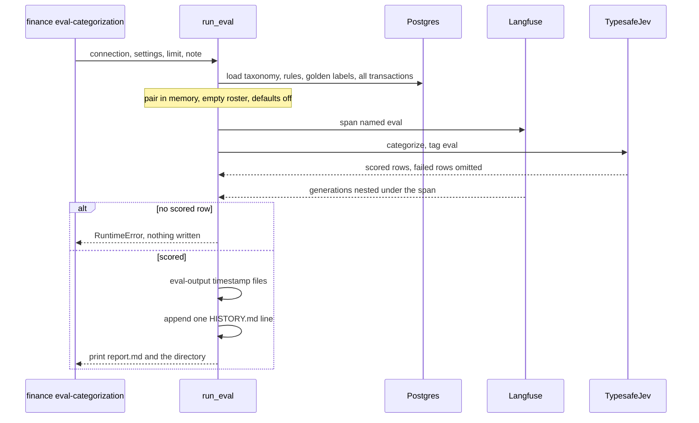

# Run the categorization eval

`finance eval-categorization` scores the production cascade against the golden set: the latest `source = 'user'` label of each transaction. It is a dry run. It does not update categories, merchants, notes, or defaults. Use it after a change to criteria, rules, thresholds, or the jev version. It is not a CI command, and it is not a chat eval.

The cascade it reuses is [Categorization cascade](../concepts/categorization-cascade.md). The labels it scores are written by [Review and labels](review-and-labels.md). Which test to run instead of a paid benchmark is [Verify a change](../operations/verify-a-change.md).

## Run it

From `apps/api`, with the repo-root `.env` already pointing at the database that holds the labels:

```bash
uv run finance eval-categorization --note "what changed"
```

`--note` is the text that lands in the Note cell of `docs/evals/HISTORY.md`. Write what changed, not a score. A pipe in the note becomes `/`, and a line break becomes a space, so the table stays one line of ten columns. `--limit N` scores only the first N golden rows after the query's order (`N` must be at least 1). Omit it for the full set. A limit is a smoke check, not a number you can compare with a full-set line.

The command prints `report.md` and `saved to <directory>`. Exit 1 means nothing was recorded: `TYPESAFE_API_KEY` is unset, there are no user labels, or jev failed on every golden row. The stderr line is `eval-categorization: ...`. A limit below 1 exits 2 before any run starts.

The run needs `SUPABASE_DB_URL` (the same connection the CLI uses for import and categorize) and `TYPESAFE_API_KEY`. Langfuse keys are optional. Without them the SDK logs a warning and records nothing. The eval does not skip jev the way `finance categorize` does when the key is missing.

This spends money. The report estimates cost as input tokens times `0.042 / 1_000_000`. The v1 spec's planning figure was about $0.05 per 400 labelled rows. That is why the command stays out of CI. Do not set `RUN_LIVE_JEV=1` to turn the unit suite into this benchmark.

## What one run does

`run_eval` loads the taxonomy and enabled rules, opens one Langfuse span named `eval`, and calls the production `categorize` with a `TypesafeJev` client tagged `eval`. Concurrency is `jev_concurrency` (default 8). Every jev generation nests under that span. The span output is only the scored-row count and the failed count. The client flushes Langfuse when it closes.

The golden query is `distinct on (transaction_id)` over `transaction_labels` where `source = 'user'`, latest `labeled_at` first, joined to the transaction, account, and labelled merchant. System, rule, and merchant history rows are not the golden set. A confirm that relabelled rows is in the set, because each of those rows got a `user` history row. A rename or merge that was not a confirm is not. Notes are not scored.

Two things are deliberately different from a production run, so the labels are not scored against themselves:

- Merchant defaults are off (`use_merchant_defaults=False`), and the roster passed in is empty. A default and a known merchant both come from the labels being scored.
- Pairing is computed in memory with `find_pairs` over every transaction, using `transfer_pattern` and `transfer_window_days`. It does not call `pair_transfers`, so it does not write `transfer_pair_id` or a rule label. A golden row that pairs in that pass is scored as `own_accounts` with confidence 1, the same rule the cascade would apply.

Everything else is the production path. A paired row never calls jev. Otherwise the first matching categorize rule wins. Remaining rows get one jev call (`merchant_name`, `category`, `is_subscription`), then merchant resolution against the empty roster. Refund rules still narrow the options jev sees. `link_loans` does not run. The eval never calls `save`.

A row whose jev call fails, or whose answer cannot be used, is left out of every metric. The others are still scored. The history Note cell then contains `failed=N`. If that drops the scored set to zero, the command raises and writes neither the output directory nor a history line.



One eval: read the golden set, score it with the production cascade without writing the database, then record metrics only if at least one row scored.

## Where the results go

| Output | Tracked? | What it is |
| --- | --- | --- |
| `eval-output/<YYYYMMDD-HHMMSS>/report.md` | No (git-ignored) | The readable tables. This is what the command prints. |
| `eval-output/<YYYYMMDD-HHMMSS>/summary.json` | No | `meta` (time, jev model, fingerprint, note, input tokens, failed) and the full `metrics` object. |
| `eval-output/<YYYYMMDD-HHMMSS>/rows.csv` | No | One row per scored transaction. Failed rows are absent. |
| `docs/evals/HISTORY.md` | Yes | One appended metrics line. No bank text. |
| Langfuse span `eval` | Remote | The run, with nested `jev.categorize` generations tagged `eval`. |

`rows.csv` columns are the `EvalRow` fields: transaction id, the text sent as `bank_concept | merchant`, direction, golden and predicted slug and level 1, confidences, subscription flag and score, and merchant names. That file is the place to see which rows moved. Do not paste it into the history note, a commit message, or this wiki. It contains bank text.

`summary.json` also holds the confidence buckets and the threshold table that the history line compresses. The fingerprint is the first 8 hex characters of a SHA-256 over categories in the order jev sees them, plus the rules, with display names excluded. Renaming a category does not change it. Reordering categories or editing a rule does. It is in the report header and in `summary.json`. It is not a HISTORY.md column.

The report header names the jev model, that fingerprint, the scored-row count, an approximate dollar cost, and the note. If any golden row was left out, it adds `N left out: jev failed`.

## How to read a run

The history table is the comparison surface. Its columns, in order:

| Column | Meaning |
| --- | --- |
| Date | Local date of the run. |
| Source | `eval` for this command. The 2026-09-23 `spike v6`, `v7`, and `v7b` lines are the pre-production spike, jev only, with no pairing or rules. |
| jev | Model string returned by the call. Current lines are `jev-1.13.0`. |
| Golden rows | Rows scored, not rows left out. A `failed=N` note means N golden rows were excluded. |
| L2 acc | Level-2 accuracy: predicted slug equals the golden slug, over every scored row. A missing confidence counts as 0 for the buckets, not as a skip. |
| L1 acc | Level-1 accuracy, using level-1 confidence (the sum of the chosen group's leaf probabilities). A wrong leaf in the right group is still right here. |
| Precision @0.95 | Of rows whose level-2 confidence is at least 0.95, the share whose slug matched. This is the acceptance threshold (`category_threshold`, default 0.95). |
| Review @0.95 | Scored rows below 0.95. The report's threshold table also has 0.80, 0.85, and 0.90. The history line does not. |
| Subs P / R | Subscription precision and recall as `hits/total · hits/total`, expenses only, flag on when noul is above 0.7. |
| Note | What changed, plus `failed=N` when any row was left out. |

Subscription precision is: among outgoing rows the run flagged, how many the user had marked as subscriptions. Recall is: among rows the user marked, how many the run flagged and that were outgoing. Rows with a null golden subscription are left out of both. A rule row has no noul, so it is not flagged. Merchant accuracy (same `match_key`, letters and digits only) is in the report and in `summary.json`, not in the history table.

The report also breaks level 2 and level 1 into confidence buckets `0.00–0.50`, `0.50–0.70`, `0.70–0.85`, `0.85–0.95`, and `0.95–1.00`, each with a row count and the share that were right. Use that table when a headline accuracy move is really a shift of mass across the 0.95 gate.

## Do not read the history as a trend

Two facts in [HISTORY.md](../../docs/evals/HISTORY.md) make a later line not a continuation of the previous one.

The golden set changed size:

- The 2026-09-23 spike lines and the 2026-09-24 production line score **412** rows.
- The 2026-09-25 line scores **480**. After the 2026-09-24 eval, review labels from a newly imported monthly statement joined the set, and 6 labels of a mixed merchant were corrected from one category to per-charge categories.
- The 2026-09-26 and 2026-09-27 lines score **684**.

Compare a line only with another line of the same golden-set size, and say which size. A drop from 87.4% (412) to 82.3% (480) is a different set, not a regression. The 2026-09-23 spike lines are also a different system: jev only, no pairing and no system rules. The first production line is 2026-09-24.

jev noise is about ten rows between identical runs. The 2026-09-23 v7 and v7b lines exist to measure that: 83.3% then 84.0% level-2 on the same 412 rows. A move smaller than about ten rows is noise. On 684 rows, ten rows is about 1.5 percentage points. The 2026-09-26 hint lines (86.0%, 85.8%, 86.8%, 87.0% level-2) sit inside that band. Do not call a one-point move a win.

The latest line in the file, 2026-09-27, 684 golden rows, jev-1.13.0: level-2 87.0%, level-1 89.2%, precision at 0.95 of 98.2%, 287 rows to review, subscription precision 50/51 and recall 50/60. The note is `restaurants not_for: Amazon and Prime Video`. That line is a measurement of that wording on that set, not a target and not a trend endpoint.

## What this command is not

There is no chat eval command. Chat evals are [backlog item 6](../../docs/backlog.md): a golden set of questions with reference SQL, run with repeats. Do not invent `finance eval-chat` or point this command at the agent. The chat does not use jev.

The spike scripts under `docs/superpowers/spikes/2026-09-23-jev-categorization/` are history. Measure a production change with this command, not with `run.py` / `report.py` there.

Langfuse Datasets and Experiments are not built. The trace above is the observability that exists.

`finance labels export` and `finance labels import` are how the golden set survives `supabase db reset`. Export defaults to `data/labels/labels-YYYYMMDD.csv` and refuses to overwrite unless `--force` is passed. Import loads by `dedup_key` and does not restore merchant defaults. The CSV and `data/` are not documentation. Do not describe their contents. The restore rule is in [CLAUDE.md](../../CLAUDE.md). Scoring after a reset still requires the statements to be imported again, because the eval joins labels to `transactions`.

## When to run it, and what else to run

Run the paid command when the change can move a scored decision: category criteria, a system rule, the taxonomy order jev sees, `category_threshold`, `subscription_threshold`, pairing window or pattern, or a jev upgrade. Put that in `--note`.

Do not run it to verify a refactor that the unit tests already lock, and do not run it against a scratch database that has no user labels. A scratch copy has no golden set unless you imported one. Importing the real labels into a scratch database is a labels write. Name recipe R2 and follow [CLAUDE.md](../../CLAUDE.md). Do not invent the recipe.

| Change | Check first | Paid eval |
| --- | --- | --- |
| Metric math, history-line shape, fingerprint | `cd apps/api && uv run task test` on `tests/test_eval_metrics.py` | No |
| Dry run writes nothing, failed rows stay out, one `eval` span | `uv run task test-integration` on `tests/test_eval_run.py` | No. The test replaces `TypesafeJev` and fails if a real client is constructed. |
| CLI flags and the exit codes | `tests/test_cli.py` under `task test` | No |
| Criteria, rules, thresholds, taxonomy order, jev version | The unit or integration test for that piece, then this command on the labelled database | Yes, full set, with a note |
| Chat prompt or semantic layer | There is no eval. See [backlog item 6](../../docs/backlog.md). | No |

`tests/test_eval_run.py` is marked `integration` for the whole file, so `uv run task test` never runs it. `tests/test_eval_metrics.py` is a unit test and does run in CI. Neither is a substitute for a line in `HISTORY.md`.
